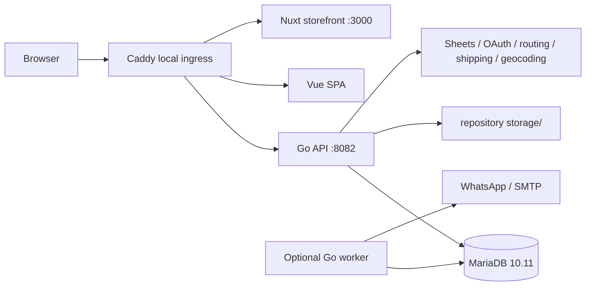

# 02 — System Architecture

Arsitektur aplikasi aktif PrimeClassy V2: Go backend, Vue/Nuxt frontend, shared MariaDB, dan storage pada root repository. Nama kontrak historis yang masih muncul pada tabel atau payload menggambarkan kompatibilitas data; tidak memerlukan Laravel/PHP saat runtime.

## 1. Topology

Domain lokal tunggal: `http://primeclassy-go-local.kmsit.localhost`. Caddy mengarahkan `/api`, `/sanctum`, `/up`, dan media publik ke Go; halaman storefront ke Nuxt; serta halaman SPA ke Vue. `/sanctum` adalah jalur kompatibilitas yang ditangani Go. Compose lokal tidak memiliki PHP-FPM, Laravel bridge, scheduler, atau worker Laravel.

## 2. Backend dan batas keamanan

Source aktif berada di `backend/`. Router API, autentikasi session, validasi, otorisasi, response envelope, dan handler domain berada pada `internal/api`. Domain dipisah ke package seperti `auth`, `catalog`, `checkout`, `cms`, `dispatch`, `inventory`, `orders`, `payment`, `reporting`, `shipping`, dan `users`.

Server Go adalah satu-satunya security boundary. Role dibaca dari database, tidak dipercaya dari klaim klien. Ownership dan scope Agen diperiksa pada API/domain layer. Frontend permission map hanya mengatur visibilitas; ia bukan otorisasi.

Session Go disimpan pada tabel `pc_go_sessions`, terpisah dari tabel bisnis historis. Migrator Go hanya membuat skema yang dimiliki Go (`pc_go_sessions`, `go_migrations`) dan tidak membuat ulang atau menghapus schema/data bisnis.

## 3. Transaksi, inventory, dan finansial

- Order, pembayaran, refund, shipment, dan perubahan stok yang terkait bisnis harus menjaga transaksi database.
- Urutan lock kanonis: Order → Stock Request → inventory target. Sub inventory: parent `WarehouseSubLocation` → target `WarehouseStock` → reservation rows.
- Multi-target kapasitas Agent menggunakan urutan target kanonis bersama. Perhitungan status/sum saat lock menggunakan locking reads agar tidak membaca snapshot lama.
- Jangan mempercayai stock source atau location dari klien; resolusi server tetap kanonis.
- Pergerakan stok dan audit finansial menyimpan aktor, referensi, dan jejak yang dapat ditelusuri. Tidak ada perubahan identitas, kepemilikan historis, atau data finansial selama konsolidasi ini.
- Notifikasi durable hanya diantrekan setelah transaksi bisnis commit. Operasi yang dapat diulang memakai idempotency key dan menjaga response replay.
- Jangan menyelesaikan deadlock dengan sleep atau menelan error 1213; perbaiki urutan lock dan verifikasi dengan regresi dua koneksi.

Rincian invarian bisnis terkunci ada di [05-BUSINESS-RULES](05-BUSINESS-RULES.md). Struktur dan kunci route ada di [matriks parity](21a-IMP010-API-PARITY-MATRIX.md): 375 route GO; 19 route REM-11 Historical POS dikecualikan.

## 4. Frontend

- Vue/Vite SPA melayani dashboard dan sebagian besar storefront interaktif; Nuxt merender halaman publik yang memerlukan SSR/SEO.
- Browser memakai same-origin API/session cookie. Vite/Nuxt dev proxy mengarah ke Go API lokal.
- Media publik dibaca melalui Go `/storage/*`; media privat hanya melalui endpoint Go yang memeriksa otorisasi.
- PWA service worker tidak menyimpan cache API, session, atau media privat.
- Bahasa aktif: `id`, `en`, `ar`, `zh`; request SSR tidak meneruskan cookie atau Authorization pengguna ke API.

## 5. Integrasi dan worker

Worker Go opsional dijalankan dengan Compose profile `async`. Jangan aktifkan pada data uji/pemulihan sebelum transport eksternal dibatasi ke sandbox. Integrasi API menggunakan konfigurasi lokal dan kredensial yang disimpan di luar Git. Container Caddy dan MariaDB merupakan shared infrastructure dan bukan milik lifecycle aplikasi Compose ini.

## 6. Histori dan production boundary

Laravel merupakan sumber kompatibilitas selama migrasi; source aktifnya tidak berada di repository Go-only ini. Matriks parity dan test fixtures menyimpan kontrak yang sudah diverifikasi. Production VPS, DNS, database, storage, dan live routing tidak diubah oleh finalisasi lokal ini. Perubahan production memerlukan mandat dan preflight terpisah.
