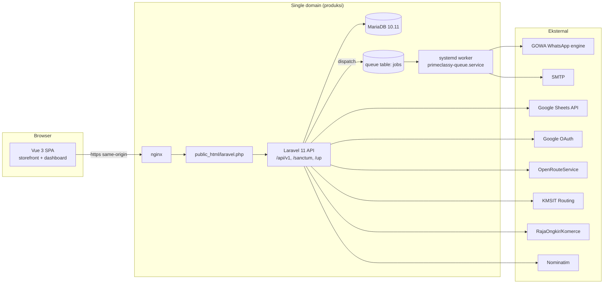

# 02 — System Architecture

Arsitektur teknis PrimeClassy V2 berdasarkan source code aktual. Fokus: topologi, struktur backend, layanan kanonis, batas transaksi, locking, idempotency, dan arsitektur frontend.

---

## 1. Topologi aplikasi

- **Single-domain layout (produksi):** document root `public_html/` berisi build SPA + `laravel.php` (bridge) + `.htaccess` + `config.js` + symlink `storage`. nginx merute `/api`, `/sanctum`, `/up` ke Laravel via `laravel.php`; sisanya SPA dengan history fallback (`backend/bootstrap/app.php` mengalihkan public path bila `public_html` ada). Template: `deploy/public_html/laravel.php`, `deploy/public_html/.htaccess`.
- **DEV lokal (ServBay):** `php artisan serve` (port 8000) + Vite dev server (5174) — detail di [13-DEPLOYMENT-OPERATIONS](13-DEPLOYMENT-OPERATIONS.md).
- **Autentikasi SPA:** Sanctum cookie session — frontend memanggil `/sanctum/csrf-cookie` sebelum setiap write stateful; middleware `EnsureFrontendRequestsAreStateful` aktif di group `api` (`backend/bootstrap/app.php`).

## 2. Struktur backend

Middleware stack global/api (`backend/bootstrap/app.php`):

| Middleware | Peran |
|---|---|
| `ReflectOriginBeforeInstall` (prepend global) | Koreksi CORS saat installer belum terkunci |
| `PreventApiResponseCaching` (append global) | Anti cache tepi (LSCache) untuk semua respons |
| `EnsurePreInstallSafeDrivers` (prepend api & web) | Driver aman sebelum DB dikonfigurasi |
| `SetLocale` (prepend api) | Locale request untuk pesan validasi |
| `EnsureFrontendRequestsAreStateful` | Sanctum SPA session |
| alias `role:` → `EnsureRole` | Gate role kasar di route; **selalu** dibaca ulang dari DB, bukan klaim klien (`backend/app/Http/Middleware/EnsureRole.php`) |
| alias `agent.linked` → `EnsureAgentLinked` | Semua user non-super_admin harus terikat Agen aktif |
| alias `not.installed` → `EnsureNotInstalled` | Menyegel installer setelah `installed.lock` |

Penanganan exception terpusat di `backend/bootstrap/app.php` (validation → 422 JSON, auth → 401, authorization → 403, model-not-found → 404, custom `ApiException`), dengan format respons seragam dari `App\Support\ApiResponse`.

Domain controller (`backend/app/Http/Controllers/Api/V1/`): Address, Admin, Agent, Auth, Catalog, Checkout, Cms, Consent, Courier, Crm, Dispatch, Fee, Fulfillment, Install, Integration, Invoice, Language, Media, Order, Payment, Promo, Referral, Region, Report, Return, Settings, Stock, User. Endpoint lengkap: [08-BACKEND-API](08-BACKEND-API.md).

## 3. Layanan kanonis (per domain)

Sumber: `backend/app/Services/`. Daftar utama beserta tanggung jawab inti:

| Domain | Service | Tanggung jawab |
|---|---|---|
| Checkout | `Checkout/CheckoutService`, `CheckoutStepResolver` | Validasi cart/alamat, quote ongkir, langkah checkout dinamis, pembuatan order (idempotency `Idempotency-Key`) |
| Order | `Order/OrderService`, `OrderTotalCalculator`, `OrderFilterService`, `OrderFulfillmentService`, `OrderLineAdditionService` | Pembuatan order (konsumen/admin/CRM-assisted), kalkulasi total kanonis, filter scoping, penyesuaian kuantitas/reschedule/split (R-03), SC-03 add-line |
| Pembayaran | `Payment/PaymentService`, `AvailablePaymentMethodService`, `PaymentSummaryService` | Satu-satunya penulis `paid_amount`/`remaining_amount`/`payment_status`; kebenaran pembayaran level-Order; metode per role |
| Refund | `Refund/RefundLedgerService`, `CancellationFinancialService`, `OrderFinancialSnapshotService` | Ledger refund (obligation/attempt/payout/event), snapshot finansial immutable, finalisasi pembatalan |
| Retur | `Order/ReturnService` | Review retur, inspeksi Gudang, finalisasi, restock |
| Stok | `Stock/StockService` (`canonicalReservationTargets`), `SellableStockService`, `StockSourceResolver`, `WarehouseStockService`, `StockTransferService`, `StockOpnameService`, `StockRequestService`, `StockRequestProposalService`, `SubStockService`, `SubStockRequestService`, `WarehouseStockRequestService`, `SubLocationOwnershipService` | Reservasi, pergerakan bucket, transfer, opname, request chain, kepemilikan Sub Location |
| Pengiriman | `Shipping/ShippingQuoteService`, `CourierService`, `DeliveryVerificationService`, `ShipmentCanonicalizationService`, `SalesKurirSubEligibilityService`, kalkulator jarak (`OpenRoute/ Kmsit/ Haversine`) | Quote ongkir, assignment kurir, verifikasi pengiriman, kanonisasi shipment (§11), eligibilitas SKS (CR-001) |
| Notifikasi | `WhatsApp/OrderNotifier`, `WhatsAppDelivery`, `GowaClient`, `Notifications/{TransactionalEmailNotifier, AdminNotificationService, FinanceRecipientResolver}` | Event → template → policy → kanal (WA/email/in-app) → ledger idempotent — lihat [10-NOTIFICATIONS](10-NOTIFICATIONS.md) |
| Komisi | `Commission/CommissionService` (+ `CommissionFinalizer`) | Baris fee per item/type; finalisasi saat `terkirim` |
| Laporan | `Report/ReportService`, `DashboardKpiController` (backend) | Laporan operasional/finansial per scope aktor |
| Integrasi | `GoogleSheets/*`, `Crm/*`, `Geocode/*`, `Setting/*`, `Media/*`, `User/*`, `Auth/*`, `Referral/*`, `Pricing/*` | Ekspor Sheets, CRM customer, reverse-geocode, settings, media, akun |
| Support kanonis | `Support/{HierarchyRules, PermissionMap, PhoneNormalizer, WhatsAppNumber, EndpointGuard, CollectibleReceivable, SafeSchema, InstallLock, ApiResponse, …}` | Aturan hierarki, hint permission frontend, normalisasi telepon, guard endpoint, AR kanonis |

## 4. Representasi stok & reservasi

Warehouse-authoritative (default `config('warehouse.authoritative')`):

- Bucket warehouse: `transit`, `factory_plan`, `sub`, `shipping` (di `warehouse_stocks`, unik per agent+produk/variasi+bucket+lokasi).
- **Agent Sellable = Transit + (Factory Plan bila aktif) − Agent Reserved**; fallback legacy `quantity_on_hand − quantity_reserved` untuk target tanpa baris warehouse (§8 [05-BUSINESS-RULES](05-BUSINESS-RULES.md)).
- **Sub Sellable = Sub Physical − Sub Reserved aktif** (`sub_stock_reservations`, satu baris per order item).
- Setiap perubahan menulis `stock_movements` immutable dengan aktor + referensi.
- Legacy `POST /stock/adjust` ditolak (403) pada mode authoritative (`AdjustStockRequest::authorize()`); hint `stock.adjust.legacy` di `PermissionMap` mengikuti config yang sama.

## 5. Batas transaksi

- Semua penulisan order/shipment/stok berjalan dalam DB transaction dengan **locking read** (`lockForUpdate`) pada baris yang dijamin konsisten.
- Notifikasi **selalu** di-defer ke `DB::afterCommit` (`OrderNotifier::defer`): transaksi yang di-rollback tidak mengirim apa pun; kegagalan gateway tidak pernah menggagalkan operasi bisnis.
- Pembatalan inventory reversal (`InventoryCancellationService`) transaksional & idempotent.

## 6. Locking & pencegahan deadlock

Urutan lock kanonis (terkunci — AGENTS.md §11):

1. **Order** (baris `orders`) → 2. **Stock Request** → 3. **inventory target** (warehouse stocks / reservations).
- Multi-target Agent capacity memakai urutan target kanonis tunggal `StockService::canonicalReservationTargets` — tidak ada vocabulary urutan kedua.
- Sub domain order: `WarehouseSubLocation` (parent) → Sub `WarehouseStock` target → Sub reservation rows.
- Rekonsiliasi status/sum di bawah lock memakai locking read, bukan `sum()` polos (snapshot REPEATABLE READ).
- 1213 (deadlock) tidak pernah "diperbaiki" dengan sleep atau ditelan — urutan diperbaiki + regresi dua-koneksi deterministik.

## 7. Idempotency

| Operasi | Kunci idempotency | Evidence |
|---|---|---|
| Buat order | header `Idempotency-Key` → `orders.idempotency_key` UNIQUE(konsumen_id/crm_customer_id, key) | migrasi `2026_09_06_090100`, `2026_10_30_100000` |
| SC-03 add-line | header `Idempotency-Key` → `order_items.idempotency_key` UNIQUE(order_id, key); replay identik → 200, berbeda → 409 | `2026_10_02_100000` |
| Request fingerprint order item | `request_fingerprint` (SHA-256, write-once) | `2026_10_02_110000` |
| Fulfilment stock request | `stock_request_fulfillments(stock_request_id, idempotency_key)` | `2026_09_17_100040` |
| Notifikasi WhatsApp | `whatsapp_messages.idempotency_key` = `txn:{event}:{subject}:{id}[:{role}]` | `OrderNotifier`, `2026_10_31_100000` |
| Notifikasi email | `email_messages.idempotency_key` = `mail:{event}:{subject}:{id}:{user}` | `TransactionalEmailNotifier` |
| In-app notif | `admin_notifications.dedupe_key` | `AdminNotificationService` |
| DP settlement request | request ekuivalen (order + pending `dp_settlement` + nominal remaining) → replay 200 | [05-BUSINESS-RULES](05-BUSINESS-RULES.md) §13 |
| Delivery verification | `Idempotency-Key` + UNIQUE(verified_by, key); replay identik valid | `2026_10_01_100001` |

Frontend mengirim identitas request `secureUuid` (UUID aman) untuk header `Idempotency-Key` (lihat [07-FRONTEND-GUIDE](07-FRONTEND-GUIDE.md)).

## 8. Audit logging

- `activity_logs` (causer, subject morph, event, description, properties, IP, user agent — migrasi `2026_09_05_090080` + `2026_09_14_090000`), ditulis via `Logging/ActivityLogger`.
- Super Admin membaca lewat `GET /admin/audit-logs` (read-only).
- `refunds.php`/`AuditCatalog` — jejak audit domain masing-masing.

## 9. Arsitektur frontend

- **Entry**: `frontend/src/main.ts` → router (`router/index.ts`, 60+ route, guard `beforeEach`: installer check → auth bootstrap → `requiresAuth`/`guestOnly`/`requiresPermission`/`requiresAnyRole`).
- **Layout** 3: `ShopLayout` (storefront publik), `AuthLayout`, `DashboardLayout` (panel internal).
- **State**: Pinia stores — `auth` (session + `PermissionMap` capability hints), `cart`, `site`, `locale`, `ui`, `install`, `wishlist`.
- **API client**: `frontend/src/api/client.ts` (Axios, baseURL `VITE_API_URL` atau same-origin; interceptor 401/CSRF retry) + 44 modul domain.
- **PWA**: service worker + halaman `/install` (landing instal PWA publik) + `OfflineView`.
- **i18n**: `id`, `en`, `ar`, `zh`.
- Detail halaman & mapping: [07-FRONTEND-GUIDE](07-FRONTEND-GUIDE.md).

## 10. Refund ledger (arsitektur data)

Sumber kebenaran uang keluar (Owner mandate 2026-10-22): `refund_obligations` (kewajiban, status lifecycle) → `refund_attempts` (percobaan berbayar, idempotent per attempt_no) → `refund_payouts` (realisasi) → `refund_ledger_events` (append-only). Satu snapshot finansial immutable per order (`order_financial_snapshots` + units + `order_item_financial_bases`) membekukan basis alokasi diskon. `commission_adjustments` ada skemanya namun **tanpa logika generasi** (OD-05 framework, belum diimplementasikan).

## 11. Keamanan arsitektural

- Backend = satu-satunya security boundary; frontend hanya visibility (`PermissionMap` eksplisit "never a security boundary").
- Otorisasi dua lapis: gate role di route (`EnsureRole`) + ownership/scope di Policy/Service (17 policy di `backend/app/Policies/`).
- Scoping global per-Agen via `BelongsToAgentScope` (model `Order`, `WarehouseStock`, dst.).
- Bukti pembayaran baru disimpan di disk privat (`proof_disk = local`), disajikan hanya lewat `GET /payment-proofs/{id}` yang cek otorisasi.
- Bukti verifikasi nomor WhatsApp (`whatsapp_number` challenge) tidak pernah disimpan plaintext / di-log.
- Detail: [12-SECURITY](12-SECURITY.md).
