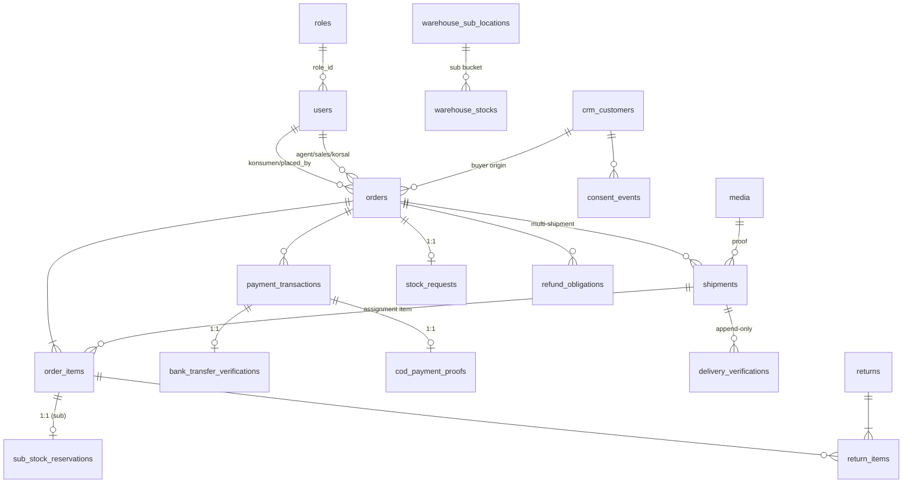

# 09 — Database Model

Model data berdasarkan migrasi (`backend/database/migrations/`, 162 file) dan model Eloquent (`backend/app/Models/`, ±110 model). Total ±100 tabel bisnis + tabel framework (cache, jobs, sessions, personal_access_tokens, password_reset_tokens). Evidence = nama file migrasi.

---

## 1. Identitas & hierarki

| Tabel | Kolom kunci | FK/Constraint |
|---|---|---|
| `users` | name, email (NULL, unique), email_verified_at, password, role_id, phone (normalisasi, unique), referral_code (unique), status enum(active/inactive/suspended), parent_id/agent_id/korsal_id/sales_id, avatar_media_id, softDeletes | FK → roles (RESTRICT), users (NULL ON DELETE), media |
| `roles` | slug (unique), name | slug: 11 role (§ [04-ROLES-PERMISSIONS](04-ROLES-PERMISSIONS.md)) |
| `user_closures` | ancestor_id, descendant_id, depth | UNIQUE(ancestor, descendant) — closure hierarki |
| `agent_profiles` | user_id (unique), store_name, address, lat/long, phone | FK → users CASCADE |
| `konsumen_addresses` | user_id, label, recipient_name, phone, address_line, is_default + FK wilayah | FK → users CASCADE, provinces/regencies/districts/villages |
| `couriers` | type enum(internal/external), user_id (unique), agent_id, external_code, name, is_active | FK → users |
| `languages` | code (unique), is_default, is_active, sort_order | id/en/ar/zh |
| `user_social_identities` | provider, provider_user_id, provider_email, last_login_at | UNIQUE(provider, provider_user_id) & (user_id, provider) |
| `provinces/regencies/districts/villages` | PK string (2/4/6/10), rajaongkir_city_id | CASCADE berantai |
| `identity_otp_challenges` | purpose, code_hash, sent_to_email, attempts, expires_at, verified/consumed/invalidated | FK agent/subject/created_by/crm_customer |
| `crm_customers` | name, phone, customer_type, relation, prospect_percent, archived_at, linked_konsumen_id | UNIQUE(owner_user_id, phone); FK linked → users |
| `crm_visits` | visit_date, status (N,1–7), prospect_percent, note, plan_next_date | FK customer/agent/user |
| `crm_customer_link_events` | event_type, otp_challenge_id, reason | FK crm/ konsumen/ aktor |
| `consent_events` | event_type, purpose, scope, evidence, consent_key, policy_version + root_event_id (self) | append-only (model menolak UPDATE/DELETE) |

## 2. Katalog

| Tabel | Keterangan |
|---|---|
| `product_categories` | parent self-FK, slug unique, is_active, sort_order |
| `products` | category_id, created_by, slug unique, has_variations, base_price, status enum(draft/active/inactive), sku (unique), short_description, softDeletes |
| `product_variations` | sku unique, price, weight, is_active, softDeletes |
| `product_variation_attributes(+options)` | axis variasi + nilai |
| `product_variation_compositions` | variasi = kombinasi axis (unique per axis) |
| `product_attributes` | atribut bebas produk |
| `product_images` | variation_id nullable, path, is_primary, sort_order |
| `product_fees` / `product_variation_fees` | beneficiary_role enum(agent/sales/courier), amount per unit, unique(product, role) |
| `product_stocks` / `product_variation_stocks` | legacy stok per Agen (on_hand, reserved) — fallback |
| `stock_movements` | type enum 16 nilai, quantity signed, sub_location_id, transfer/handover/opname/request reference, immutable |
| `catalog_skus` | sku PK, owner morph — satu namespace SKU |
| `product_discounts` | agent_id, percentage, is_active, periode (tanpa FK) |
| `vouchers` | agent_id, code (unique per agen), type(percentage/fixed), max_uses, product target XOR |
| `products(+variation…)_translations` | FK language |

## 3. Order & pembayaran

### orders

| Kolom | Tipe/Enum | Catatan |
|---|---|---|
| order_no | varchar(30) unique | nomor invoice |
| idempotency_key | varchar(80) | UNIQUE(konsumen_id, key) & UNIQUE(crm_customer_id, key) |
| konsumen_id / crm_customer_id / placed_by_user_id | FK nullable | buyer origin (XOR di model `saving`); placed_by write-once |
| buyer_name_snapshot / buyer_phone_snapshot | | snapshot buyer CRM-origin |
| sales_id / korsal_id / agent_id | FK | snapshot rantai saat order |
| payment_method_id | FK nullable | |
| status | enum(diterima, diproses, dikirim, terkirim, dibatalkan, pengembalian, kembali) | transisi `Order::TRANSITIONS` |
| payment_status | enum(unpaid, pending_verification, partially_paid, paid, partially_refunded, refunded, failed) | |
| subtotal/discount/shipping_fee/admin_fee/total_amount | decimal(12,2) unsigned | |
| dp_amount / paid_amount / remaining_amount | decimal(12,2) | DP accounting |
| gross_received_amount | decimal(14,2) | "G" — tidak pernah berkurang saat refund |
| region snapshot + region_id terstruktur + postal_code + voucher_id | plain (tanpa FK) | |
| recipient/phone/address/lat/long snapshot | | |
| delivery_date_estimate / actual | | |
| cancelled_at/by/reason | | |
| cancellation_financial_status / finalized_at | enum(not_applicable, pending_reconciliation, finalized) | |
| due_date, invoice_issued_at | date/timestamp | + audit `order_due_date_changes`, snapshot `order_invoice_snapshots` |

### order_items

shipment_id (multi-shipment), split_from_order_item_id (lineage R-03), idempotency_key + request_fingerprint (SC-03), stock_source enum(agent/sub) + sub_location_id (CHECK konsistensi), snapshot produk/variasi/SKU/harga/fee (agent/sales/courier)/subtotal, original/fulfilled_quantity, cancelled/returned/refund/additional_quantity, requested_delivery_date, handed_over_at, status enum Indonesia.

### pembayaran

| Tabel | Keterangan |
|---|---|
| `payment_methods` | code unique (cod, bank_transfer, down_payment), type enum(manual/gateway/cod) |
| `payment_transactions` | type(payment/refund/additional_payment), status normalisasi(pending, paid, failed, expired, cancelled, refunded), gateway_reference, raw_payload |
| `bank_transfer_verifications` | status(pending/verified/rejected), submitted/verified_amount + amount_adjustment_reason, channel(transfer/cash), cash_received_by/receipt_reference, proof_disk, paid_by_role, submitted_by/at, verified_by/at |
| `cod_payment_proofs` | proof_media_id, **collected_amount** (REM-004: nominal nyata; NULL = legacy seluruh transaksi), status(pending/confirmed/rejected), submitted_by/paid_by_role |
| `order_additional_payments` | status(pending/paid/failed/cancelled), method(transfer/cod), reason; verifikasi parsial: obligation asal pending sebesar sisa + transaksi residual baru, bagian diterima menjadi row paid terkait transaksi awal; total amount riwayat tetap; tautan item asal tidak dipindah |
| `order_item_adjustments` | kuantitas dikurangi, refund_amount, refund_status |
| `payment_webhook_logs` | (tabel ada; tanpa gateway aktif) |
| `order_due_date_changes`, `order_invoice_snapshots` | audit due date; invoice versi immutable |

### refund ledger

| Tabel | Keterangan |
|---|---|
| `order_financial_snapshots` (+units) | snapshot finansial immutable per order (basis alokasi) |
| `order_item_financial_bases` | basis per item |
| `refund_obligations` | obligation_no, source_type(return_stage/fulfillment_shortfall/cancellation/manual/legacy/deferred), status(pending/approved/partially_paid/completed/needs_verification/cancelled), deferred amount |
| `refund_attempts` | attempt_no, method(bank_transfer/gateway/cash), status(created/processing/succeeded/failed/unknown/cancelled), idempotency_key unique |
| `refund_payouts` | payout_no, affects_paid_amount, verification_status(proven/legacy_unverified) |
| `refund_ledger_events` | append-only, event_key unique |
| `order_sales_reductions` | sumber pengurangan (return/shortfall/cancellation/reinstatement) |
| `refund_migration_batches` | batch backfill |
| `refund_recipient_evidences` | bukti penerima refund (encrypted destination) |
| `commissions` | beneficiary_role(agent/sales/courier), amount signed, status(pending/approved/paid/reversed) |
| `commission_adjustments` | ada schema, **tanpa writer** (OD-05) |

## 4. Pengiriman

| Tabel | Keterangan |
|---|---|
| `shipping_providers` | code(rajaongkir/openroute/kmsit), is_active (semua seed nonaktif) |
| `shipping_configurations` | per-agen tarif Kurir Toko: price_per_km, minimum_distance_km, minimum_charge, free-shipping |
| `shipments` | order_id (multi), courier_id, shipping_provider_code snapshot, rate_per_km, provider_meta, tracking_number, status(pending/picked_up/in_transit/delivered/failed), proof_media_id (wajib saat delivered), delivery_mode(standard/self_sub) + self_delivered_by_user_id (CHECK + 2 trigger), shipped/delivered_at |
| `shipping_couriers` | master kurir provider-supported (RajaOngkir/Komerce) |
| `delivery_verifications` | outcome(received/not_received/return), verified_by, idempotency_key; append-only |
| `order_fulfillment_change_proposals` | usulan perubahan kuantitas/tanggal (diputuskan Admin) |
| `stock_requests` (+items, +fulfillments) | satu per order (item Agent-source), status derived pending/partial/fulfilled; fulfilment idempotent; **coordinator_requested_by/_at/_note** (REM-001: permintaan Koordinator terakhir; riwayat di activity_logs); item: **damaged_hold_qty** (F07: unit rusak tertahan sampai diselesaikan Admin) |
| `inventory_cancellation_reversals` | pembalikan stok saat pembatalan (unique per item) |

## 5. Retur

| Tabel | Keterangan |
|---|---|
| `returns` (model ReturnRequest) | status(requested/under_review/approved/rejected/processing/completed), total_refund_amount, consent_event_id |
| `return_items` | quantity_returned/received/good/damaged, refund_amount, refund_status(not_required/pending/processed/failed), status(pending/approved/rejected), condition_status(pending/good/damaged/mixed), courier_id (claim), pickup_scheduled_for, inspected_by/at, disposition_status |

## 6. Warehouse / stok

| Tabel | Keterangan |
|---|---|
| `warehouse_stocks` | agent + product/variation XOR + stock_type(transit/factory_plan/sub/shipping) + sub_location_id; generated columns + CHECK |
| `warehouse_sub_locations` | code unique per agen, owner_user_id UNIQUE (1:1 SKS) + previous_owner, contact_number |
| `warehouse_settings` | factory_plan_enabled per agen |
| `sub_stock_reservations` | order_item_id UNIQUE — status(active/consumed/released), release_reason |
| `stock_transfers` (+items) | source/destination bucket + sub_location, status(pending/completed/cancelled/rejected) |
| `stock_handovers` | satu per transfer; status(pending/handed_over/received/cancelled) |
| `stock_opnames` (+items) | type(physical_opname/plan_reconciliation/sellable_reconciliation), status(draft/submitted/approved/rejected/cancelled) |
| `stock_request_proposals` (+items) | proposal Gudang (= jumlah disiapkan) → **penerimaan Koordinator Kurir** (REM-002: `received_by/received_at/receipt_note`; item `accepted_qty/short_qty/damaged_qty`, NULL = disetujui Admin legacy/pengecualian); item decision(pending/approved/rejected) |
| `delivery_refusals` | REM-003: penolakan pelanggan saat pengantaran — order_item/shipment, quantity, reason, status(with_courier→handed_back→received→redelivery\|returned_to_warehouse), recorded/handed_back/received/disposition by+at. Bukan `return_items` (retur pasca-delivery tidak berubah) |
| `warehouse_stock_requests` | addition/sub_adjustment → approval Admin |
| `sub_stock_requests` (+items) | direction(replenish/return), status(requested/approved/rejected/cancelled/executed/received), stock_transfer_id |
| `warehouse_migration_runs/markers` | tooling migrasi legacy |

## 7. CMS & settings

| Tabel | Keterangan |
|---|---|
| `cms_pages`, `cms_articles`, `cms_homepage_blocks` (+translations) | status, published_at, content JSON; block type varchar(50) |
| `settings` | key unique, value, group, is_public |
| `agent_payment_method_settings` (+active_environment) | per-agen on/off metode |
| `agent_payment_gateway_configs` | kredensial terenkripsi per agen+metode+environment |
| `agent_shipping_provider_settings` / `agent_shipping_provider_configs` | per-agen on/off + kredensial |
| `google_auth_settings` (global) / `agent_google_auth_configs` | OAuth (secret terenkripsi) |
| `invoice_configs` | agent_id 0 = global; config JSON |
| `agent_profiles` | store profile "Kontak Agen" |

## 8. Notifikasi

| Tabel | Keterangan |
|---|---|
| `whatsapp_messages` | idempotency_key unique, purpose(transaction/otp/test), event, template_class(full/restricted), recipient_role/phone, sender_device_id, status(queued/…), attempts, error, skip_reason — ledger murni |
| `agent_whatsapp_devices` | device_id unique, state(not_paired/connected/…), phone_masked, paired_at |
| `agent_whatsapp_event_settings` | per-agen event switch + template override (NULL = warisi global) |
| `agent_whatsapp_test_numbers` | allow-list nomor uji per agen |
| `email_messages` | idempotency_key unique, event, recipient_email, status — ledger |
| `admin_notifications` | dedupe_key unique, per-penerima, type/severity, read_at — Notification Center |

## 9. Media & audit

| Tabel | Keterangan |
|---|---|
| `media` | disk, path, collection, mime, size, mediable morph, created_by |
| `activity_logs` | causer morph, subject morph, event, description, properties, IP, user_agent |
| `sheets_destinations/configs/sync_logs` | integrasi Google Sheets (connection_status, dataset, baris proses) |

## 10. Relasi inti (ringkas)

## 11. Catatan penting lintas-migrasi

- Tabel dihapus: `payment_gateway_configs` (diganti konfigurasi per-agen `2026_09_20_090002`); kolom `shipping_providers.config` dan `payment_methods.active_environment` dihapus.
- Enum berevolusi: `payment_transactions.status` (normalisasi 09_07), `orders.payment_status` (+`partially_paid`), `order_items/return_items.status` (09_09), `beneficiary_role` (+courier 09_10), `stock_movements.type` (→16 nilai), `stock_transfers.status` (+rejected), `stock_request_proposals.status` (+partial).
- Constraint DB-level: XOR product/variation di movement/transfer/request; `order_items_stock_source_consistent`; `shipments_delivery_mode_consistent` + 2 trigger anti-courier-di-self_sub; `chk_warehouse_sub_location_type` + generated columns di `warehouse_stocks`.
- Kolom penting tanpa FK (plain bigint): region_id + voucher_id di orders; product_discounts/vouchers; snapshot `order_initial_report_items`; `proof_media_id` refund; `transfer_id/handover_id` di stock_movements; `invoice_configs.agent_id` (0 = global).
- Migrasi FK-restoration `2026_10_08_110000/111000/112000` idempotent (no-op di DB ter-migrasi benar).
- Data seed: payment methods (cod/bank_transfer/down_payment aktif); shipping providers (rajaongkir/openroute/kmsit, semua nonaktif); languages (id default, en, zh, ar); google_auth_settings row id=1.
