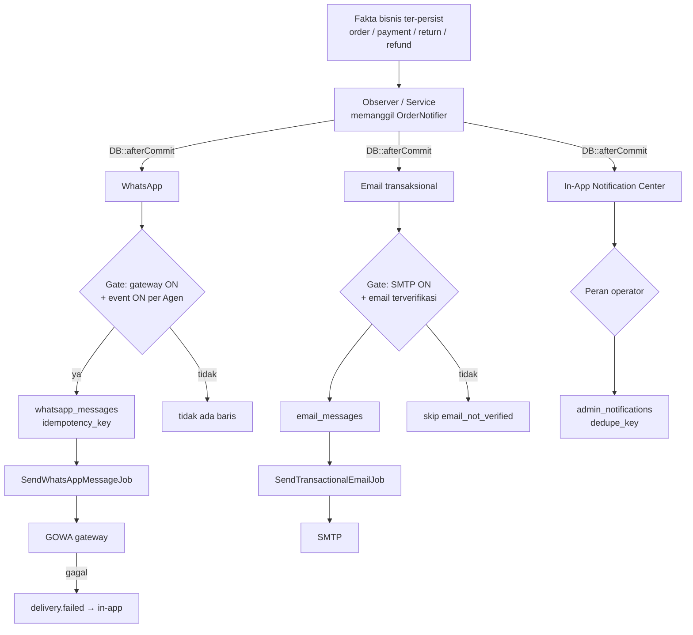

# 10 — Notifications (Sistem Notifikasi — REL005 & REL006)

Dokumentasi implementasi aktual sistem notifikasi. Source: `backend/app/Services/WhatsApp/*`, `backend/app/Services/Notifications/*`, `backend/app/Jobs/*`, migrasi `2026_10_31`–`2026_11_05`.

---

## 1. Arsitektur alur

Prinsip (§28 [05-BUSINESS-RULES](05-BUSINESS-RULES.md)): satu fakta bisnis → maksimal satu pesan per kanal; semua gate kanal independen (WA off tidak membisukan email); notifikasi best-effort — kegagalan tidak pernah menggagalkan operasi bisnis; tidak ada duplikat senyap (idempotency key unique).

## 2. Katalog event (16 — `WhatsAppEvents`)

| Event | Label | Pemicu | Penerima |
|---|---|---|---|
| `order_created` | Pesanan berhasil dibuat | order dibuat | pembeli akun (WA/email); operator (in-app) |
| `payment_paid` | Pembayaran berhasil | transaksi terverifikasi (lunas) | pembeli; operator |
| `payment_partial` | DP / pembayaran sebagian | DP/parsial terverifikasi (`partially_paid`) | pembeli |
| `payment_proof_uploaded` | Bukti pembayaran baru (perlu verifikasi) | bukti transfer tersimpan & commit (REL006) | **Keuangan cabang saja** |
| `payment_failed` | Pembayaran belum berhasil | bukti transfer di-reject | pembeli; operator |
| `order_processed` | Pesanan diproses | status order `diproses` | pembeli |
| `order_shipped` | Pesanan dikirim | shipment `dikirim` | pembeli |
| `order_delivered` | Pesanan selesai | shipment `terkirim` | pembeli |
| `order_cancelled` | Pesanan dibatalkan | order dibatalkan | pembeli |
| `return_requested` | Retur diajukan | retur dibuat | pembeli; operator |
| `return_approved` | Retur disetujui | review approve | pembeli |
| `return_rejected` | Retur ditolak | retur selesai tanpa item approve | pembeli |
| `refund_requested` | Permohonan refund | obligation pending | pembeli; operator |
| `refund_approved` | Refund disetujui | obligation approved | pembeli |
| `refund_rejected` | Refund ditolak | needs_verification → cancelled | pembeli |
| `refund_completed` | Refund berhasil | payout sukses | pembeli |

Setiap event punya `variables` allow-list + `required`; baris template dengan variabel opsional yang tak tersedia **dihilangkan**, tidak diarang. Footer standar: "Pesan otomatis dari PrimeClassy. Jangan membagikan OTP atau kata sandi kepada siapa pun."

**Yang TIDAK ada:** event "dikemas" (status tidak ada); notifikasi promosi/marketing (out of scope by design).

## 3. WhatsApp engine (GOWA)

- Engine: GOWA (`go-whatsapp-web-multidevice` v9 — image `sapakita/gowa:v9.6.0`), client `GowaClient` (endpoint sesuai OpenAPI GOWA, `Http::baseUrl(settings->baseUrl())`).
- **Device per Agen** (`agent_whatsapp_devices`): pairing QR/pair-code, reconnect, logout, replace (`replaced_count`); state machine `not_paired → connected → …`; observer `WhatsAppLifecycleObserver` melaporkan perubahan koneksi → in-app `gateway.status` (+ Super Admin).
- **Template per Agen:** `agent_whatsapp_event_settings` — baris scoped meng-override template global/flag ON-OFF; NULL = warisi global. Preview (`previewEvent`) memakai data contoh jelas-palsu.
- **Kirim:** `WhatsAppDelivery` — enqueue ke `whatsapp_messages` (status `queued`) → job `SendWhatsAppMessageJob` → GOWA → update status (sent/failed/unknown) + retry terbatas (`max_attempts`, bukan untuk `unknown`/OTP).
- **Kebijakan penerima:** `OrderRecipientResolver` — pembeli akun (primary, template `full`, nomor ber-proof); admin/checkout-recipient (template `restricted` via `RestrictedDeliveryPolicy`). Nomor tanpa proof → skip `number_not_verified` (baris tetap tercatat). Order CRM-origin → skip `recipient_not_verified`.
- **RestrictedDeliveryPolicy (R-01/CL-05):** satu-satunya pengecualian "harus nomor ber-proof": (a) notice status order ke nomor penerima checkout (role `recipient`, hanya event status `ORDER_EVENTS` — tidak pernah event finansial); (b) notice registrasi akun baru (role `registrant`, event `account_registered`). Body restricted = teks server tetap (tanpa link/OTP/data finansial); divalidasi ulang saat kirim (nomor masih nomor penerima order terkini).
- **Rate limit:** per-penerima 6/jam, gateway 20/menit (hard bounds, Super Admin); throttle menunggu (bounded); semua ter-audit.

## 4. Email transaksional

- Gate: `SmtpSettings::transactionalEnabled()` — SMTP dikonfigurasi Super Admin di dashboard (global; agen tidak bisa mengubah) + switch transaksional sendiri (default OFF).
- Penerima (event order umum): admin cabang + akun pencipta order (pembeli/pengsubmit) — masing-masing hanya dengan **email terverifikasi**; penerima checkout (bukan akun) tidak pernah menerima email; order CRM-origin di-skip penuh.
- Subjek per event (`TransactionalEmailNotifier::SUBJECTS`); body = teks kontrak `WhatsAppEvents` default yang sama (template Agen tetap WhatsApp-only).
- Idempotency: `mail:{event}:{subject}:{id}:{user}` UNIQUE; job `SendTransactionalEmailJob`.
- Kegagalan → in-app `delivery.failed` (NTF-033).

## 5. In-App Notification Center

- Tabel `admin_notifications`; fan-out **satu baris per penerima** (read selalu scope pemanggil — tanpa permukaan IDOR).
- Penerima: operator cabang (Agen + Admin cabang itu) untuk fakta cabang; fakta platform (delivery failure, gateway status) + semua Super Admin.
- Event yang difan-out (NTF-030): `order.created`, `payment.failed`, `return.requested`, `refund.requested`; plus `payment.proof_uploaded` (khusus Keuangan — §7), `delivery.failed`, `gateway.status`, dan `fulfillment.shortage` (**PEMENUHAN KURANG**: Admin + Agen cabang, tertaut ke order, satu per penyerahan Gudang yang kurang).
- Dedupe: `dedupe_key` unique per penerima; body ringkas operasional tanpa nomor telepon/kredensial/OTP/data bank.
- Endpoint: `GET /notifications/admin`, `/unread-count`, `POST /read-all`, `/{id}/read` (role super_admin, agen, admin, keuangan). Frontend: `AdminNotificationsView.vue`.
- Prune: `admin-notifications:prune`.

## 6. Pengaturan pengiriman per Agen

- Saklar event per-Agen + template custom + test numbers + device management: dikelola **Agen** (miliknya) dan **Admin Agen** (Agen cabang, resolusi server `WhatsAppScope`; `agent_id` klien di luar scope → 403). Audit mencatat aktor & target terpisah.
- Super Admin: global ON/OFF, koneksi GOWA pusat, kebijakan OTP, batas volume, retry pesan gagal, console template global.
- Default: **gateway OFF, semua event OFF** — tidak ada event aktif hanya karena terdaftar di kode.

## 7. REL006 — `payment_proof_uploaded` (detail implementasi)

**Trigger:** `PaymentService` memanggil `OrderNotifier::paymentProofUploaded(...)` **di dalam transaksi upload bukti**; seluruh pengiriman di-defer `DB::afterCommit` — upload yang di-rollback tidak menotifikasi siapa pun. Identitas upload = `$proofHash` (sha256 file): re-upload file identik menghasilkan key sama → tidak ada duplikat.

**Resipien (Owner rule 2026-11-02):** `FinanceRecipientResolver` — **hanya role `keuangan` AKTIF dari cabang order** (`agent_id` = order's agent). Tanpa fallback ke Super Admin/Admin/Agen/kreator/penerima checkout/konsumen. Akun yang juga Keuangan tetap hanya melalui role & cabangnya sendiri. Tanpa resipien → warning log `payment_proof.no_authorized_finance_recipient`, tidak dikirim.

**Kanal & gate per kanal:**

| Kanal | Gate tambahan | Baris |
|---|---|---|
| WhatsApp | gateway ON + event aktif untuk Agen order + nomor WA resipien ber-proof | `txn:payment_proof_uploaded:bank_transfer_verification:{id}:{proofHash}:u{user}` |
| Email | SMTP transaksional aktif + **email resipien terverifikasi** | `mail:payment_proof_uploaded:…:{user}`; email belum terverifikasi → baris `skipped`/`email_not_verified` tanpa kirim |
| In-App | selalu (tanpa gate channel) | `payment.proof:{verificationId}:{proofHash}:{userId}` |

**Konten:** variabel `nama_keuangan`, `nomor_pesanan`, `nama_pelanggan`, `total`, `nominal_klaim` (submitted), `waktu_upload`, `link_verifikasi_pembayaran` (URL absolut `/orders/{id}` bila `frontend_url` dikonfigurasi; tanpa config baris link hilang). Pesan eksplisit: *"Unggahan bukti pembayaran bukan konfirmasi bahwa dana telah diterima"* — **tidak otomatis mengesahkan pembayaran** (status order/pembayaran tidak berubah oleh event ini).

**Idempotency & failure isolation:** key unique per (verification, file-hash, user); replay = no-op; kegagalan kanal (apapun) ditangkap try/catch + log `notify.payment_proof.channels_failed` dan tidak mengganggu kanal lain maupun operasi upload.

**Status produksi (riwayat laporan Owner, bukan pengganti verifikasi ulang):** merge & deployment REL006 berhasil; WhatsApp Agen 11 aktif; email transaksional aktif; WA ke nomor teruji berhasil; email ke alamat terverifikasi berhasil; **email akun Keuangan ID 18 sebelumnya belum terverifikasi** (jangan dianggap PASS tanpa bukti baru); **E2E browser In-App & ledger event bukti pembayaran belum dikonfirmasi** (status NOT VERIFIED untuk runtime, kode terverifikasi).

## 8. Queue worker

- Jobs: `SendWhatsAppMessageJob`, `SendTransactionalEmailJob` — koneksi `database`, lane `primeclassy-notify` (prioritas) + `default`.
- Produksi: systemd `primeclassy-queue.service` (flock anti-double, `Restart=always`, `$tries=1`, ExecStop `queue:restart`) — aktif sejak 2026-11-02 (aktivasi Owner; detail [13-DEPLOYMENT-OPERATIONS](13-DEPLOYMENT-OPERATIONS.md) §7).
- OTP (WA & email) tetap **sinkron** fail-closed — tidak lewat queue, tidak di-retry.
- Scheduler cron sudah ada (`/etc/cron.d/primeccookies-scheduler` `schedule:run` per menit) namun `schedule:list` = tanpa task (no-op).

## 9. Retensi (kontrak — eksekusi terbatas)

- `whatsapp_messages`: 90 hari operasional (minimize, baris tetap) — `whatsapp:retention-report`/`minimize` tersedia; eksekusi minimize butuh approval Owner + backup.
- OTP challenge expired/void: 30 hari (`otp:retention-purge`).
- Consent evidence: aktif + 5 tahun (CI-06, report-only).
- Legal hold menangguhkan semua.

## 10. Bukti verifikasi (evidence source map)

| Klaim | Evidence |
|---|---|
| Katalog event & template default | `backend/app/Services/WhatsApp/WhatsAppEvents.php` |
| Orkestrasi & defer after-commit | `backend/app/Services/WhatsApp/OrderNotifier.php` |
| Resipien keuangan | `backend/app/Services/Notifications/FinanceRecipientResolver.php` |
| Policy restricted | `backend/app/Services/WhatsApp/RestrictedDeliveryPolicy.php` |
| Email gate & subjek | `backend/app/Services/Notifications/TransactionalEmailNotifier.php` |
| In-app fan-out | `backend/app/Services/Notifications/AdminNotificationService.php` |
| Pengiriman WA & retry | `backend/app/Services/WhatsApp/WhatsAppDelivery.php` |
| Engine GOWA | `backend/app/Services/WhatsApp/GowaClient.php`, `GowaDeviceClient.php` |
| Manajemen device/event per Agen | `AgentDeviceService.php`, `AgentWhatsAppSettingsService.php` |
| Ledger & gate runtime | migrasi `2026_10_31_100000`, `2026_11_0*_1000*` |
| Worker | `deploy/production/primeclassy-queue.service` |
