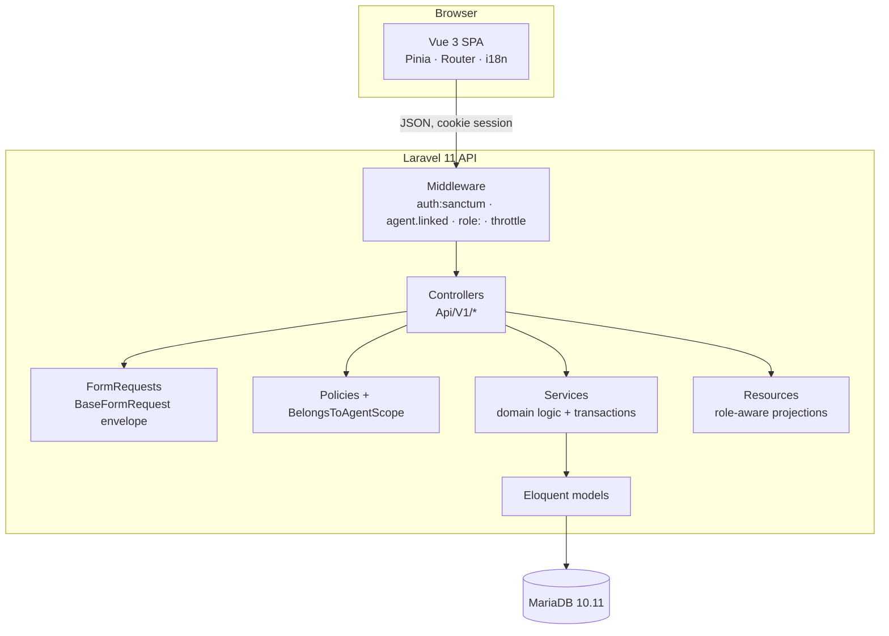
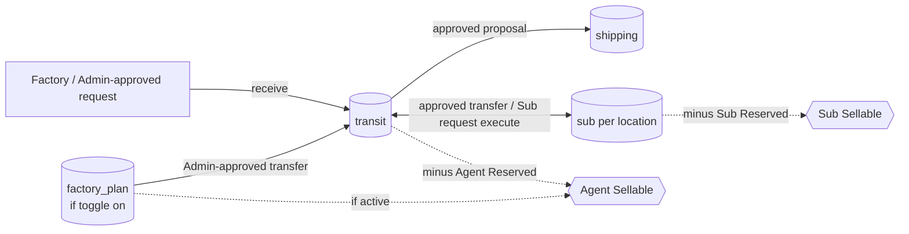
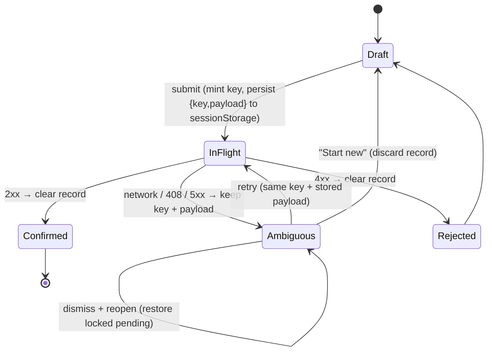

# Prime Classy — Technical Architecture

How the system is built. Behavioural rules are in [BUSINESS-RULES.md](BUSINESS-RULES.md); the system overview is [MASTER-SYSTEM.md](MASTER-SYSTEM.md); runbooks are [OPERATIONS.md](OPERATIONS.md). Everything here is verified against source; names refer to `backend/app/...` and `frontend/src/...`.

## 1. Overview



Request path: **route role gate → FormRequest shape validation → controller `authorize()` (Policy) → Service (authoritative rules, DB transaction, locks) → Resource (role-filtered output)**. Authority is never decided in one layer alone.

## 2. Backend structure

| Layer | Location | Notes |
|---|---|---|
| API surface | `routes/api_v1.php` | One file; groups by `role:` middleware; throttles on auth/checkout/Sheets |
| Controllers | `app/Http/Controllers/Api/V1/{Address,Admin,Agent,Auth,Catalog,Checkout,Cms,Courier,Fee,Fulfillment,Install,Integration,Language,Media,Order,Payment,Referral,Region,Report,Return,Settings,Stock,User,Webhook}` | Thin: authorize → service → resource. `ok()/created()/fail()` produce the envelope |
| FormRequests | `app/Http/Requests/*` (extend `BaseFormRequest`) | Shape validation only; failures render `{success:false, message, errors}` 422. Business validation that depends on state lives in services |
| Policies | `app/Policies/*` | Record-level authority (Order, Shipment, DeliveryVerification, StockRequest/Proposal/Transfer/Opname/Handover, SubStockRequest, WarehouseSubLocation, WarehouseStockRequest, User, Product…). `OrderPolicy::addLine` = Admin-only, same Agent |
| Global scope | `app/Models/Scopes/BelongsToAgentScope` | Confines Order/ProductStock/ProductVariationStock queries to the actor's Agent (not applied to `User` to avoid auth recursion) |
| Services | `app/Services/{Order,Payment,Stock,Report,Shipping,GoogleSheets,Hierarchy,Referral,User,Fee,Checkout,Cms,Media,Region,Sanitizer,Setting,Export,Logging,Product,Maintenance}` | All business logic and transactions |
| Resources | `app/Http/Resources/*` | `OrderResource`/`OrderItemResource` (financial vs operational projection), `CourierOrderResource` (minimal pre-claim vs assigned), report/warehouse resources |
| Models | `app/Models/*` (~80) | Snapshots, enums, relations; `SoftDeletes` on users/products/variations |
| Support | `app/Support/*` | `ApiResponse`, `HierarchyRules`, `PermissionMap` (UI hints), `InstallLock`, `SafeSchema` |
| Exceptions | `app/Exceptions/*` | `ApiException(message, status, errors)` → envelope; `InsufficientStockException`, `InvalidStateTransitionException`, `ShippingQuoteException` |
| Console | `app/Console/Commands/*` | `regions:import`, `products:backfill-sku`, `system:audit-catalog-hierarchy`, `warehouse:reconcile`, `warehouse:migrate-legacy-stock`, `transactions:reset` (legacy), `products:reset` (FULL Product domain reset — dry-run by default; `--force` additionally requires `--backup-verified=<reference>`, and the run is refused when the schema holds a dependency the delete scope does not cover; see [docs/OPERATIONS.md](OPERATIONS.md) §8.2), `primeclassy:reset-dev-transactions` (DEV only), `primeclassy:reconcile-order-shipments` (DEV only; legacy duplicate-shipment consolidation — refuses non-DEV databases and refuses the whole order on any unsafe candidate) |

## 3. Canonical services

**Financial** (one writer per concern)

| Concern | Owner |
|---|---|
| Order totals after creation | `OrderTotalCalculator::recalculate` (only writer of `subtotal_amount`/`total_amount`) |
| `paid_amount`, `remaining_amount`, `payment_status` | `PaymentService` (`applyPaymentToOrder`, `reverseAppliedPayment` re-read the Order with `FOR UPDATE` before each increment/refund; `reconcileTotals`, `initiateAdditionalPayment`) |
| Payment summary shown anywhere | `PaymentSummaryService::summarize` |
| Proof submission (konsumen / branch staff / Korsal-Sales on behalf) | `PaymentService::submitBankTransferProof` / `submitCodPaymentProof` — lock order verification (or COD proof) row → transaction → order, same as verify/confirm; authority `OrderPolicy::payOnBehalf` + `PaymentController::authorizeProofSubmission` |
| DP settlement request (pelunasan) | `PaymentService::requestSettlement` — **Order-first** transaction; idempotent replay returns the one existing pending `dp_settlement` transaction (HTTP 200, `replay=true`) instead of a second one; a request whose nominal no longer matches a pending settlement is refused with `messages.payment.already_processed` and the pending one is preserved |
| Fees snapshot | `FeeService::resolveForLine` → `OrderService::priceAndReserveLine` |
| Commission rows | `OrderService::recordCommission` (agent/sales), `CourierService::recordCommissionsForItems` (courier) |
| Additional-payment obligation rule | `OrderFulfillmentService::reconcileAdditionalObligation` (shared by fulfilment increase and SC-03) |
| Effective unit price (discounts) | `PricingService::activeDiscount` / `effectiveUnitPrice` — variation-targeted > product-targeted, only currently-valid rows (A1-09); `ProductDiscountController`/`VoucherController` (agent-scoped, `role:super_admin,agen,admin`) |
| Voucher resolution + applicability | `VoucherService::resolve`/`isApplicableTo`/`consume` (row-locked), `OrderService::voucherBudgetForLines` (single fixed face-value budget — A1-06/07) |
| Dynamic invoice PDF | `InvoiceConfigService::resolved` (agent → global → defaults), `InvoicePdfService::render` (Barryvdh dompdf, viewer-aware A1-13/22), `InvoiceController` (owner + same-branch financial roles) |

**Inventory**

| Concern | Owner |
|---|---|
| Agent reserve / release / lock helpers | `StockService` (`reserveFor*`, `release*`, `lockReservationTarget(s)`, `canonicalReservationTargets`) |
| Sellable formula | `SellableStockService` (+ `WarehouseStockService` orchestration) |
| Sub reservation lifecycle | `SubStockService` (`reserve`, `consume`, `release`, `reduce`, `increase`, `lockReservationTargets`) |
| Stock source decision | `StockSourceResolver` |
| Sub Location ownership | `SubLocationOwnershipService` |
| Order Stock Request | `StockRequestService` (create on `diproses`, `lockActiveRequestForOrder`, `appendItemForOrderItem`) |
| Proposal / approval (Agent physical move) | `StockRequestProposalService`; `StockRequestFulfillmentService` is a disabled stub (direct fulfilment returns 422) |
| Gudang "Order Diproses" queue | `WarehouseOrderController` (queue listing + per-order internal stock request), scoped server-side to `status = 'diproses'` AND no courier assigned |
| Transfers / handovers | `StockTransferService` |
| Warehouse requests / opname | `WarehouseStockRequestService`, `StockOpnameService` |
| Sub requests | `SubStockRequestService` |
| Cancellation reversal | `InventoryCancellationService` |
| Returns | `ReturnService` (`requestReturn`, `review`, `inspectReturn`, `finalizeInspection`, pickup/confirm, `markItemRefunded`) |
| Order lifecycle | `OrderService` (create, status, cancel), `OrderFulfillmentService` (quantity/reschedule/split + the canonical delivery-date regroup), `OrderLineAdditionService` (SC-03), `CourierService`, `DeliveryVerificationService` |
| Sales-Kurir-Sub delivery eligibility (CR-001) | `SalesKurirSubEligibilityService` (per-shipment predicate: same Agent, active, own purchase / own sales snapshot / current referral scope; read-only candidate list) + `CourierService::resolveSalesKurirSubExecutor` (profile resolve on the assignment write path, race-safe via `couriers_user_unique`) + `CourierService::assertMayOperateShipment` (deactivated executors refused authoritatively) |
| Canonical Shipment grouping (one Shipment per order + date) | `ShipmentCanonicalizationService` (eligibility `mergeBlocker`, plan/apply, in-transaction `mergeGroupInto`), driven by `OrderFulfillmentService::consolidateIntoShipmentForDate`; shared by checkout, whole-line reschedule, reschedule split and SC-03 |
| Shipment lifecycle aggregate (`status`/`shipped_at`/`delivered_at`) | `CourierService::syncShipmentAggregate` — derived from the shipment's OWN items and monotonic; shared by the per-item, per-shipment and office bulk paths |
| Region lookup / reverse geocode | `RegionController`, `GeocodeService` + `ReverseGeocoder` interface (`NominatimReverseGeocoder` is the configurable live default; shared cache/atomic rate gate, exact unique master-chain matching and safe manual fallback; `POST /checkout/geocode`) |

## 4. Stock and reservation representation



- `warehouse_stocks(agent_id, product_id|product_variation_id, stock_type, sub_location_id, quantity)`; `stock_type ∈ transit, factory_plan, shipping, sub`; `sales` is never stored.
- Legacy `product_stocks` / `product_variation_stocks`: `quantity_reserved` is the **Agent reservation commitment** (still authoritative); `quantity_on_hand` is a legacy projection. Manual legacy adjustment is locked by `config('warehouse.authoritative')`.
- `sub_stock_reservations` (one per `order_item_id`, UNIQUE; `active → consumed | released`). `order_items.stock_source` (`agent|sub`) + `sub_location_id` with a DB CHECK.
- `stock_movements`: immutable, signed, typed (`reserve, release, transfer_in/out, fulfillment, cancellation_release, return_restock, opname_adjustment, out, sub_adjustment, legacy_backfill …`), target XOR (`product_id` / `product_variation_id`), referencing the owning document.

## 5. Transaction boundaries

Each mutating operation is one `DB::transaction` that takes its locks first and writes the document, stock, movements, financial effect and audit row together. `StockService::reserve*` deliberately does not open its own transaction so it composes inside `OrderService`/`OrderLineAdditionService`. Idempotent replays resolve **before** creation-only validation. Operations that can be retried carry a persisted key or a unique constraint (see §8).

## 6. Order creation and SC-03 flows

```mermaid
sequenceDiagram
  participant A as Admin (SPA)
  participant C as OrderFulfillmentController::addItem
  participant S as OrderLineAdditionService
  participant DB as MariaDB
  A->>C: POST /orders/{id}/items (Idempotency-Key, payload)
  C->>C: authorize(addLine); validate key (1..100 chars)
  C->>S: addLine(...)
  S->>DB: BEGIN; lock Order
  S->>DB: replay? (order_id, idempotency_key) → compare fingerprint
  alt same fingerprint
    S-->>C: existing line (replay=200)
  else different
    S-->>C: 409
  else new
    S->>S: status=diproses? no Sub items? date not past?
    S->>DB: lock Stock Request (active)
    S->>DB: lock inventory targets (canonical) → reserve
    S->>DB: OrderItem + fingerprint, Shipment, StockRequestItem, commissions
    S->>DB: recalc totals → reconcile payment → obligation → audit
    S-->>C: new line (201); COMMIT
  end
  C->>DB: refresh order + relations
  C-->>A: OrderResource (persisted truth)
```

Checkout (`OrderService::createOrder`) follows the same discipline: resolve lines once (`resolveLine` → effective inventory target), take the canonical locks, snapshot + reserve + commission per line, create one Shipment per **delivery-date group** (Human UAT-005 LOCKED: same `requested_delivery_date` + compatible mode/owner → ONE canonical Shipment, the shipping-fee snapshot landing on exactly one of them), and create the Stock Request when the order starts in `diproses`. `priceAndReserveLine` is shared with SC-03 (`addReservedLine`).

## 7. Locking and deadlock prevention

Locks are always acquired in these orders. **Do not introduce a second ordering vocabulary.**

| Path | Lock order |
|---|---|
| Agent capacity (checkout, cancellation, Transit→Sub approval/execution) | targets sorted by `StockService::canonicalTargetKey` (`p:{id}` / `v:{id}`); per target: Agent commitment row → warehouse Transit/Plan rows (`lockReservationTargets`) |
| Sub-domain | `WarehouseSubLocation` parent → Sub `WarehouseStock` target rows (canonical order) → Sub reservation rows |
| Sub checkout | **shared** lock on the Sub Location (re-validated: active, same Agent, still owned) → Sub stock targets → reservations; the Gudang executor takes the location **exclusively** first, so no cycle |
| Warehouse proposal approval | Proposal → Stock Request → shared `StockService::canonicalReservationTargets` capacity prelock (Agent commitment → Transit/Plan) → Shipping |
| **SC-03 add-line** | Order → current locking executor read (new additions only) → **Stock Request** → Agent targets (canonical) → items/shipment. Stock Request precedes inventory so it matches proposal approval and cannot deadlock against it |
| **Courier assignment (A1-03/A1-04)** | **Order → Shipment** (delivery status uses this same boundary and checks executor ownership inside the transaction; re-check `diproses` + no different executor + terminal under lock; courier row re-read) — the same first lock as **proposal creation** (Order → Stock Request) so a dispatch assignment and a Gudang proposal serialize on the Order and can never interleave. Since CR-SALES-KURIR-SUB-DELIVERY-001 the boundary continues **→ Courier → executor `users` row → konsumen `users` row** (per-shipment Sales-Kurir-Sub eligibility is re-checked under the lock with locking reads; the SKS profile resolve path takes the identical prefix Order → Shipment → candidate → konsumen, so the two serialize and cannot deadlock). No flow anywhere locks a `users` row and then an `orders` row, so no cycle exists against this order. The read-only eligible-couriers list takes **no locks** (plain reads; staleness is tolerable because the write path re-validates) |
| Quantity adjustment / reschedule / SC-03 / DP settlement request / Keuangan additional-payment settlement | Adjustments/reschedules lock `Order` → `OrderItem` → the order's Shipments (canonical regroup) and use plain (non-locking) reads for pending-obligation guards. `rescheduleItemDeliveryDate` additionally re-reads the already-locked **Order** to close the fulfillment window, so a date change can never happen once the order has started shipping. `PaymentService::requestSettlement` is **Order-first** (it re-reads `remaining_amount` and converges idempotently on the one pending `dp_settlement` row through a *locking* read on the indexed `payment_transactions.order_id`), and `markAdditionalPaymentPaid` still locks its financial row first — the two orders were deliberately kept cycle-free because neither ever needs a row the other holds first |

Reconciliation rule (REPEATABLE READ): when a status or total is derived from rows that another transaction may have just committed while this one waited for a lock, use **locking reads** (`lockForUpdate()->get()` then sum in PHP), never a plain `sum()` that would use the pre-wait snapshot. `StockRequestService::appendItemForOrderItem` and `StockRequestProposalService::approve` follow this. Deadlocks are fixed by ordering, not by sleeps or catching 1213.

## 8. Idempotency

| Operation | Mechanism |
|---|---|
| Order creation | `Idempotency-Key`; `UNIQUE(konsumen_id, idempotency_key)`; duplicate returns the original order |
| Delivery verification | Required key; `UNIQUE(verified_by, idempotency_key)`; identical content replays, otherwise 409 |
| Sub stock request create | Optional key; unique per requester |
| Order stock-request fulfilment (approval) | Persisted `stock_request_fulfillments.idempotency_key = proposal-{id}`; approving twice is a no-op |
| Sub request execute / transfer approve / opname approve / reservation reserve/consume | State-based: terminal status returns the existing result; per-item UNIQUE rows |
| Payment webhooks | `UNIQUE(payment_method_id, event_id)`; races return `duplicate` |
| **SC-03 add-line** | Required key (non-blank, ≤ 100); `UNIQUE(order_id, idempotency_key)` on `order_items` + immutable **request fingerprint** |

**Request fingerprint** (`order_items.request_fingerprint`, SHA-256, written once with the line, never updated): `{product_id, product_variation_id|null, quantity, requested_delivery_date|null, additional_payment_method}`; `reason` is excluded (audit note). Same key + same fingerprint ⇒ replay; different ⇒ 409; the unique-index race path also compares fingerprints. Rows without a fingerprint (pre-remediation DEV rows) fall back to product/variation/quantity identity.

## 9. Frontend request identity (`secureUuid`)

`src/utils/uuid.ts::secureUuid()` is the **only** generator of idempotency/transaction identifiers: native `crypto.randomUUID()` → RFC 4122 v4 from `crypto.getRandomValues()` → otherwise throws (never `Math.random`/`Date.now`). Call sites: checkout, delivery verification, Sub stock requests, SC-03.

`src/utils/addLineSubmission.ts` plus `OrderDetailView.vue` implement the SC-03 submission lifecycle:



The backend 409 is the final guard if a key ever meets a changed payload.

## 10. Audit logging

`ActivityLogger::log(causerId, subject, event, description, properties)` writes `activity_logs` (never raw inserts); secret keys are redacted; IP and user agent captured server-side. Domain events cover users/referrals, payments, orders (`order.status_changed`, `order_item.added`), fulfilment, shipments/receipts, returns, stock, settings, products, Sub Locations. Some services write `ActivityLog` rows directly for warehouse documents.

## 11. Frontend architecture

- **Routing:** `router/index.ts` (history mode) with `requiresAuth`, `guestOnly`, role meta and an installer guard; dashboard routes under `DashboardLayout`, storefront under `ShopLayout`, auth under `AuthLayout`, print under `views/print`.
- **State:** Pinia stores `auth`, `cart`, `wishlist`, `locale`, `site`, `ui` (dark mode), `install`.
- **API:** `src/api/client.ts` (Axios, `withCredentials`, XSRF header; base URL from `window.__APP_CONFIG__.API_URL` runtime config, `''` = same origin) and one module per resource (`orders`, `payments`, `warehouse`, `subStock`, `proposals`, `transfers`, `opnames`, `deliveries`, `orderAdjustments`, `reports`, `catalog`, …). `ApiError` carries `status` and field errors.
- **Navigation:** `dashboard/navConfig.ts` builds the role-aware sidebar; backend remains authoritative.
- **i18n:** vue-i18n with `id`, `en`, `ar` (RTL), `zh`; backend messages in `lang/{id,en,ar,zh}` selected by `SetLocale`.
- **Build:** Vite 8 + `@tailwindcss/vite`; type-check by `vue-tsc`.

## 12. Integrations

| Integration | Where | Notes |
|---|---|---|
| OpenRouteService | `Services/Shipping/Providers/OpenRouteProvider`, `OpenRouteDistanceCalculator` | Base URL server-controlled; route cached 5 min; failure ⇒ 422, no fallback charge |
| RajaOngkir / Komerce V2 | `Providers/RajaOngkirProvider` | Rates cached 5 min, destination mapping 30 days; selection re-verified at order creation |
| Payment methods | `Services/Payment/PaymentService` | Manual bank transfer + COD; per-Agent bank config (`agent_payment_gateway_configs`, legacy table name). External gateways and their webhook were removed (Owner decision). |
| Google Sheets | `Services/GoogleSheets/{DatasetRegistry,SyncService,SheetsClient}` | Whitelisted dataset/column registry; server-side service account; one-way |
| Google Maps | frontend only | Public key; private provider keys never reach the browser |
| Google sign-in (IMP-001) | `Services/Auth/GoogleAuthService`, `Controllers/Api/V1/Auth/GoogleAuthController`, `user_social_identities` | `GOOGLE_CLIENT_ID/SECRET/REDIRECT_URI` env (empty = disabled, 503); routes in `routes/web.php` under `api/v1/auth/google` (web group = session for OAuth state, still reachable through the production `/api` bridge); back-channel code exchange with PKCE, ID-token claims validated, nothing persisted but the identity link |

### 12.1 Laporan A (Transaksi Awal) dan Laporan B (Posisi Pembayaran Terkini) — DIRETIRED (WP-04, Owner 2026-10-30)

**Status: kedua dataset DIM nonaktifkan dari surface Google Sheets.** Owner memutuskan laporan yang
redundan dihapus dari surface, datanya dipertahankan, Laporan C tetap hidup. Kontrak aktual:

- `order_initial_transactions` dan `order_payment_positions` **tidak lagi terdaftar** di
  `DatasetRegistry` (definitions/defaults/filters/catalog) — membuat config Sheets untuk dataset itu
  ditolak 422, bukan sekadar disembunyikan di menu.
- Config lama yang masih menunjuk dataset yang retired **gagal sinkron secara eksplisit**
  (`SyncService` mencatat status `failed`, pesan "Dataset tidak diizinkan"), tidak pernah menulis stub
  senyap.
- **Data tetap disimpan**: snapshot writer checkout (`OrderInitialSnapshotService::capture`)
  tetap menulis `order_initial_report_items`, dan kelas `OrderInitialReportService` /
  `OrderPaymentPositionReportService` tetap utuh di disk (bisa dipakai ulang untuk reaktivasi
  atau export historis sekali jalan). `transaction_worksheet` (Laporan C) tidak berubah.

Deskripsi asli kedua laporan (dipertahankan untuk konteks historis dan reaktivasi):

Dua laporan PrimeClassy diekspor ke Google Sheets sebagai dua dataset tambahan di
`DatasetRegistry`. Keduanya satu arah (aplikasi → Sheets); database tetap sumber kebenaran.

| | Laporan A | Laporan B |
|---|---|---|
| Dataset key | `order_initial_transactions` | `order_payment_positions` |
| Service | `Services/Report/OrderInitialReportService` | `Services/Report/OrderPaymentPositionReportService` |
| Sumber data | `order_initial_report_items` (snapshot immutable) | `orders` + `payment_transactions` (keadaan terkini) |
| Granularitas | 1 baris per item produk saat order dibuat | 1 baris per faktur (1 order = 1 faktur) |
| Cakupan histori | hanya order yang dibuat setelah snapshot aktif | order lama dan baru |
| Nilai uang | nilai saat order dibuat (tidak pernah berubah lagi) | nilai terkini (`total_amount`, `paid_amount`) |
| Sisa / piutang | `max(0, total − paid)` yang disimpan saat commit | `GREATEST(total_amount − paid_amount, 0)` dihitung saat export |
| Jumlah kolom | 24 | 15 |

**Snapshot Laporan A.** Tabel `order_initial_report_items` ditulis di dalam transaksi
checkout yang sama (`OrderService::createOrder` → `OrderInitialSnapshotService::capture`,
sebelum commit), satu baris per `order_items` pada saat itu. Isinya: identitas order, hierarki
historis (`agent_id`/`korsal_id`/`sales_id`), snapshot penerima/alamat, snapshot produk
(nama, SKU, varian, **kategori**), qty saat create, harga/subtotal baris, nilai tingkat faktur
(ongkir, diskon, admin fee, total, bayar, sisa), status pembayaran dan metode pembayaran saat
transaksi. Baris snapshot tidak pernah ditulis ulang; `order_id`/`order_item_id` cascade saat
order dihapus (DEV cleanup), `products` tidak punya FK ke snapshot sehingga histori tetap utuh
saat katalog berubah.

Aturan yang dikunci Owner:

- **Kolom tingkat faktur hanya terisi pada baris item pertama** (Ongkir, Diskon, Total
  Pembayaran, Total Bayar, Sisa) — `SUM` di sheet tidak pernah menghitung dobel.
- **Nama aktor (Agen/Korsal/Sales) memakai profil terkini** dari ID hierarki historis
  (kebijakan "actor names are the exception" di [BUSINESS-RULES.md](BUSINESS-RULES.md)); nama
  penerima dan telepon konsumen berasal dari snapshot order.
- **Kategori produk memakai snapshot kategori**, bukan kategori live.
- **Sisa Piutang tidak pernah membaca `orders.remaining_amount`** (kolom itu 0 untuk order
  non-DP yang belum diverifikasi); aturan turunan `max(0, total − paid)` dipakai di kedua laporan.
- Tidak ada kolom "Posisi Uang" pada kedua laporan (Owner menutup OQ-8 dengan menghapus kolomnya).

**Filter periode.** `sheets_configs.filters` menerima `period` (`daily`/`weekly`/`monthly`/
`custom`) plus `from`/`to` (`Y-m-d`). Periode relatif dihitung saat sinkronisasi berjalan
(`ReportPeriodFilter`) pada **kalender bisnis Asia/Jakarta (WIB)**; minggu mulai Senin, dan
batas periode dikonversi **sekali** ke UTC sebelum dibandingkan dengan `created_at` (database
tetap UTC). `custom` menutup seluruh hari WIB terakhir (`to` eksklusif = awal hari WIB
berikutnya). Filter periode hanya sah pada dataset yang mendaftarkannya di
`supportedFilters()` (kini hanya Laporan C); pada dataset lain permintaan
ditolak 422 agar tidak menjadi no-op senyap.

**Syarat database.** Laporan A memakai window function `ROW_NUMBER()`, sehingga deployment
memerlukan **MariaDB ≥ 10.2 atau MySQL ≥ 8.0** (DEV terverifikasi MariaDB 10.11.10). Versi
database produksi harus dicatat pada preflight deployment.

**Batas baris.** `config('google_sheets.max_rows')` = 10.000. Melebihi batas ⇒ **sync gagal
total** (`GoogleSheetsRowLimitException`), tab tidak ditulis, dan `error_summary` memerintahkan
mempersempit periode. Tidak ada pemotongan senyap.

**Kolom uang diekspor sebagai angka** (`numberValue`), bukan teks, sehingga sheet bisa
`SUM`; nilai kosong tetap kosong (bukan 0). Pertahanan formula injection tetap berlaku
(nilai string dikirim literal).


## 13. Security boundaries

Route role → Policy → `BelongsToAgentScope` → service re-checks. Server-derived money/stock; encrypted credentials never serialized; `HtmlSanitizerService` for HTML; real MIME/decode checks and generated names for uploads; Sanctum CSRF; throttling; `APP_DEBUG=false` in production; the installer endpoints (`/api/v1/install/*`) are CSRF-exempt but sealed by the `not.installed` middleware, which returns 403 once `storage/app/installed.lock` exists (the status endpoint also reports `has_super_admin`). Gudang/Kurir get operational resource projections with no financial fields.

## 14. Testing architecture

- PHPUnit `tests/Feature` (real DB, policies, services, migrations) and `tests/Unit`. `Tests\TestCase` applies the fail-closed `TestDatabaseGuard`: exact equality only — `APP_ENV=testing` + MySQL/MariaDB + database exactly `primeclassy_testing`; no regex/suffix acceptance (`foo_testing`, `primeclassy_dev`, `sql_prime` are all refused).
- Most suites use `RefreshDatabase`. Race suites use `RestoresIsolatedTestDatabase` (committed fixtures + rebuild) with `Tests\Support\ConcurrencyHarness`, which spawns real second PHP processes (`.phpunit-concurrency-actor.php`, whitelisted operations such as `add-line`, `proposal-approve`, `agent-reserve`, `checkout-order`) to produce **true two-connection overlap** and assert no deadlock (1213), no oversell and conserved inventory.
- `scripts/run-tests-serialized.php` serializes destructive migration/refresh suites with a lock and refuses non-testing databases.
- Schema-repair migrations are verified in two halves: a read-only suite against the fully migrated `primeclassy_testing` schema (which asserts the declared constraint lists are a faithful copy of what the create-table migrations actually produce, and that each window is a no-op there), plus a DDL suite under `RestoresIsolatedTestDatabase` for the destructive scenarios (drop a constraint, plant an orphan, prove the window refuses with zero mutations). `DevSchemaForeignKeyRestorationTest` and `DevSchemaForeignKeyRestorationDdlTest` are the worked example for the DEV FK drift remediation — procedure and evidence in [OPERATIONS.md](OPERATIONS.md) §8.3.
- Deterministic lock-order assertions (query-log inspection) complement races where timing alone cannot prove ordering.
- No frontend test framework; verification is `vue-tsc`, the Vite build and manual browser checks.

SC-03/assignment boundary (Human-approved no-inaccessible-demand sequence): SC-03 takes Order first and checks executor state with a current locking Shipment read, after original-request replay. Assignment/pickup also owns Order; before adding an executor it locks Stock Request, reads added item ids and their request demand with current locks, and refuses pending SC-03 demand. Thus assignment-first rejects new addition; SC-03-first preserves Gudang access until added stock is fulfilled. No new inventory lock order, sleep or retry is introduced.

## 15. Refund ledger (Refund Ledger v1, Owner mandate 2026-10-22)

The ledger is **additive** to the payment truth; `PaymentService` remains the only writer of
`paid_amount`.

- **Snapshot layer** — `order_financial_snapshots` (UNIQUE `order_id`) + `order_financial_snapshot_units`
  + `order_item_financial_bases`. One immutable, order-wide basis created by the first financial event
  (`first_handover`, `return_approval`, `fulfillment_shortfall`, `order_cancellation`) or by the
  backfill (`provisional_legacy_backfill`). Units are frozen once; later events consume units, never
  re-allocate. Checksum = canonical hash of order, subtotal basis, effective voucher and the ordered
  unit triplets; recomputed and compared before commit. Basis law is the frozen units
  (`Σ unit_price_snapshot × fulfilled_quantity`), never a potentially stale `orders.subtotal_amount`.
- **Ledger layer** — `refund_obligations` (obligation truth, `amount` immutable after approval) →
  `refund_attempts` (one channel execution; `created → processing → succeeded|failed`, `unknown`
  reconciled only) → `refund_payouts` (money that actually left; immutable, never deleted). Payouts are
  created only from a succeeded attempt; `UNIQUE(attempt_id)` and the conditional status update give
  exactly-once. `refund_ledger_events` is the append-only audit trail.
- **Deferred** — an entitlement above available cash (`C`) creates a zero-or-partial container and a
  deferred remainder; materialization is Owner-only, capped, idempotent by client key and superseded
  (irreversibly) on cancellation. `deferred_remaining` is the only decremented field.
- **Sales reductions** — `order_sales_reductions` records each economic reduction (gross/net,
  `applied_to_order_total`); `commission_adjustments` is a table only — original note "(formula blocked, D1)".
  **Dated supersession (2026-10-28):** the policy FRAMEWORK is now Owner-approved (OD-05a…g, canonical in
  `docs/BUSINESS-RULES.md` §15a); D1's "table only, no generation logic" remains TRUE of current source —
  exceptions PENDING_OWNER_APPROVAL, implementation and schema changes NOT authorized. See §15a.
- **Commission-adjustment read/write architecture (approved design, NOT_IMPLEMENTED; §15a)** — intended flow:
  order-item per-unit fee snapshot → commission entitlement row (`commissions`, immutable after creation) →
  approved refund obligation (`refund_obligations`, §26) as the sole policy trigger → versioned compensating
  journal entry in `commission_adjustments` (signed `amount decimal(14,2)`, `refund_obligation_id`,
  `policy_version`, `created_by`; deterministic 2-decimal allocation per OD-05f, cumulative bounded by the
  original entitlement) → reversal/reinstatement as further compensating entries reconciled against actual
  payout events (R_c) — never mutation or deletion of original rows; entitlement adjustment is distinct from
  cash refund execution throughout. Where an entitlement adjustment exceeds what the app can know it paid, the
  design produces a SEPARATE recovery balance only (OD-05e): no automatic cash deduction, no automatic offset.
- **Commission payout state — verified facts:** current source writes commission `status` only as `'pending'`;
  there is **no writer** of `approved/paid/reversed` status or `paid_at`, and no payout ledger, command or
  endpoint. The payout process is therefore **external and not source-verified** — the application does NOT
  currently know which commissions were paid, and no design here may assume that it does. External-payment
  verification is a mandatory documented prerequisite before any recovery-balance semantics can be built.
- **Schema-readiness requirements (documented; MIGRATION_NOT_AUTHORIZED, OD-05g):** `commission_adjustments`
  currently restricts `beneficiary_role` to `agent|sales` (2026_10_22_100006) while commission rows can be
  `courier` (2026_09_10_090000) — courier-role support must be added where required; a unique
  adjustment identity/idempotency key is missing today; Agent isolation (order/actor scoping + policies),
  immutability of original `commissions` rows, and stored policy version / source event / obligation reference /
  actor / audit provenance are mandatory parts of any future migration.
- **Cancellation** — `OrderService::cancel` books the B → 0 reduction and then calls
  `CancellationFinancialService::finalize` in the same transaction. Finalization defers while any
  attempt is in `created/processing/unknown` (`cancellation_financial_status = pending_reconciliation`);
  otherwise it closes only provably dead forward obligations and creates the cancellation obligation
  `min(P, C)`.
- **Metrics** — `RefundMetrics::forOrder` computes G/P/A/R_c/R_u/R_r/B/C in integer cents. R_c is
  `proven AND affects_paid_amount`; legacy historical reversals are `legacy_unverified` (R_u), never
  paid twice.
- **Reporting read-switch** — `config('refunds.reporting_source')`: `legacy` (default) keeps the old
  aggregate readers, `ledger` serves `total_refunds`/`refund_total`/`return_refund_total` from proven
  payouts. Flip only after a backfill batch is accepted; flip back for rollback.

**Lock order:** Order → snapshot → obligation → attempt/inventory. Every closing path (payout,
supersede, finalize, reinstate) re-checks the in-flight guard under the same Order lock with locking
reads, never a `sum()` snapshot.

## 16. Buyer origin — CRM-origin order contract (**approved — NOT IMPLEMENTED**; OD-01…OD-04, Owner 2026-10-28)

This is an architectural contract, not a migration plan. Nothing here is implemented: no CRM schema,
route or screen exists yet (`IMP-006 BLOCKED`, `docs/SALES-PARITY-CHECKPOINT.md`). Business authority
lives in `docs/BUSINESS-RULES.md` §27; this section defines the technical shape.

- Conceptual buyer origins: `account` (authenticated Konsumen, today's only origin) and `crm`
  (Agent-scoped CRM Customer without an account). A transaction must have **exactly one authoritative
  buyer origin** plus an immutable buyer identity snapshot (extending the existing
  `recipient_name_snapshot` / `recipient_phone_snapshot` pattern, `OrderService.php:156-157`).
- Existing source expects an account-backed buyer everywhere: `orders.konsumen_id`, the unique
  idempotency index `orders_konsumen_idempotency_unique` (`OrderService.php:72-107`),
  `Controller::resolveKonsumen()` (`app/Http/Controllers/Controller.php:32`, used by checkout and order
  controllers), `OrderPolicy` owner checks and `create` network gates (`OrderPolicy.php:156-169`), and
  consumer-scoped returns (routes `api_v1.php:347-376`). **Do not** implement CRM origin by merely
  making the FK nullable — before any schema proposal, map every consumer of those symbols.
  The consolidation package's `StoreOrderRequest` reference is **valid and active**: `App\Http\Requests\Order\StoreOrderRequest`
  (`backend/app/Http/Requests/Order/StoreOrderRequest.php`, `class StoreOrderRequest extends BaseFormRequest`) is the
  `POST /orders` validator, type-hinted in `OrderController::store()` (`:8`, `:127`); its docblock confirms server-side
  amount recompute and that `konsumen_id` is meaningful only for `agen/korsal/sales/sales-kurir-sub`. It is therefore a
  primary downstream consumer to map for CRM origin (a wrong "class absent" note was recorded earlier and is corrected
  here — see `docs/OWNER-DECISION-TRACEABILITY.md` Appendix B).
- Idempotency must be isolated by authoritative buyer origin and scope (e.g. origin-scoped key spaces) so
  CRM-context requests can never collide with, or replay against, another buyer's orders.
- Linking a CRM Customer to a Konsumen account later (OD-03/OD-04) must not change an existing order's
  buyer origin, payer/uploader/verifier identities, financial or commission snapshots, or sales/korsal/
  agent attribution. Unlinking is a future-authorization change only.
- Assisted-order creation from a CRM Customer is permitted only for the owning Sales/SKS (or their
  authorized upline within existing policy) with explicit Agent scope; backend service checks are
  authoritative, never frontend visibility.
- Returns from CRM-origin orders require a consent-evidenced delegated initiation path while retaining
  the existing return approval (`super_admin,agen,admin` review, gudang inspection, keuangan refund
  marking; `api_v1.php:289-320`) unchanged.
- Reporting must serve both origins: no report, export or Sheets dataset may drop CRM-origin orders via
  inner joins to `users` (all current report services join `o.konsumen_id → users`,
  `OrderTransactionReportService.php:39`, `OrderPaymentPositionReportService.php:55`,
  `ReportService::customersReport:479`). Sheets and Excel remain role-scoped projections of the DB,
  which stays the source of truth (§20a rules continue to apply).

### Buyer-origin downstream coverage matrix

| Consumer | Existing dependency / risk | Required design proof |
|---|---|---|
| Registration/referral | User creation and attribution | CRM does not fabricate a User or mutate historic referral chains |
| Checkout/order creation | `konsumen_id`, `resolveKonsumen`, account-backed idempotency | Origin-aware identity, uniqueness, authorization, stock/pricing snapshot |
| Order list/detail/cancel | Owner checks and role scopes | CRM owner/Agent visibility, correct cancellation gates |
| Proof upload/payment | Payer/uploader/verifier distinct | Authorized Sales/SKS submitter; finance-only verification |
| DP/COD/settlement | Payment projection and custody | No CRM bypass of the financial state machine |
| Order fulfillment/SC-03 | Item snapshots and obligations | Same stock, additional-payment and refund invariants |
| Gudang requests/transfers/opname | Stock authority | CRM origin has no stock privilege |
| Sub stock and SKS delivery | Sub owner/source | SKS ownership, reserved stock and dual-fee parity preserved |
| Dispatch/delivery verification | Shipment executor and proof | Same authorized dispatch and append-only verification |
| Returns | Authenticated Konsumen request today | Consent-backed CRM delegated initiation; remaining actors unchanged |
| Refund ledger | Obligation/attempt/payout | CRM-origin refund payee identity verified; no invented commission formula (OD-05) |
| Commission/fees | Historical snapshots and attribution | Ledger source only; never recompute from current product fee config |
| Reports/dashboard | Joins assume a `users` buyer | Both origins visible within scoped reports; no silent inner-join drops |
| Google Sheets/XLSX | Existing 17 datasets and exports | SimpleV2 43/47-column reference mapped per `docs/BUSINESS-RULES.md` §20b; no manual-column data loss |
| Audit/CMS/settings | Global vs Agent boundaries | Event traceability; no unintended permissions |

### 16a. CRM Customer identity, consent events and linking lifecycle (**CI-01…CI-07 approved — NOT_IMPLEMENTED**; Owner 2026-10-28)

Business rules: `docs/BUSINESS-RULES.md` §27a. This is a design contract, not schema authorization.

- **Identity separation.** Existing Konsumen = authenticated `users` row (role `konsumen`, `agent_id` scope,
  order buyer via `orders.konsumen_id`). Future CRM-only Customer = separate Agent-scoped business record with
  **no mandatory login and no fabricated User**. It cannot currently own or originate an order; the buyer-origin
  dependency (exactly one authoritative origin, immutable buyer snapshot, origin-scoped idempotency, and all
  listed consumers) is defined in §16 and remains the prerequisite for CRM-origin assisted checkout.
- **Consent events (proposed append-only model).** `consent_captured` / `consent_withdrawn` / `consent_disputed`
  events bound to customer + order + return request + item/quantity scope + purpose + media reference + capturing
  actor + timestamp + Agent ownership + policy version. Events are immutable; withdrawal/reinstatement is
  represented by further events; effective-time is prospective. No consent mechanism exists today.
- **Linking lifecycle (proposed, prospective only).**
  `proposed → proof of target-account control → verified-email challenge → single-use OTP → authorized link
  creation → immutable audit event → (later) unlink request → authorized review → append-only revocation event
  with prospective effective timestamp → optional re-link requiring full re-verification.`
  Requirements: OTP expiration, attempt limits/rate limiting, replay protection, one-time challenge binding to
  the intended customer/account/action; identity matching by email/phone alone is never sufficient; **no
  cross-Agent link is permitted** (CI-05), and any Agent transfer is a separate authorized process (none exists).
- **No historical rewrite.** Linking/unlinking never changes order ownership, payer/uploader/verifier identities,
  refund beneficiaries, commission attribution, or any immutable snapshot (§16 buyer-origin, §26 ledger). An
  in-flight refund is unaffected by a simultaneous unlink; payout destinations follow recorded evidence, not the
  current link.
- **Not authorized here:** database tables/columns, nullable buyer FK, endpoints, OTP provider/service selection,
  account merges, retention periods, or any UI. All remain pending Owner decisions and a future implementation
  package.

### 16b. Buyer-origin identity separation contract (**APPROVED by Owner 2026-10-30 (G17-D1…D4) — IMPLEMENTED in source; DEV migration `2026_10_30_*` PENDING Owner approval**)

Approved and implemented (Phase 2, 2026-10-30). It fixes the vocabulary so the six concepts below are never conflated.
Source-verified facts that drove it: `orders` stored `konsumen_id`, `sales_id`, `korsal_id`, `agent_id`, `cancelled_by`, recipient/address
snapshots — and **no column for who placed the order**; the idempotency unique index was account-scoped. Implementation map:
`OrderService::createOrder` (origin-scoped idempotency, exactly-one-origin guard in the service), `AssistedOrderService` (who may place, attribution carrier),
`CrmLinkService`, `ConsentService::captureForCrm`, `AssistedReturnService`, `RefundRecipientGuard`/`RefundRecipientService`; migrations
`2026_10_30_100000…100003` (additive; two nullability relaxations; **no database CHECK on historical data** — Owner forbade constraining history before an audit).

| # | Concept | Meaning | Where it lives today | Contract |
|---|---|---|---|---|
| 1 | **CRM Customer** | Agent-scoped business contact, no login | `crm_customers` (IMP-006 slice 1) | Never a `User`; never owns an order by itself; owner = one Sales/SKS |
| 2 | **Konsumen account** | Authenticated `users` row, role `konsumen` | `users` | Only an account holder may be the *account* buyer; never created/merged by CRM |
| 3 | **Order placer** (actor) | The authenticated user who submitted the order | not stored (gap) | Must be recorded immutably per order (proposed additive `orders.placed_by_user_id`, set server-side from `auth()->user()`, never from the body) |
| 4 | **Transaction owner** | Who the order/payments/returns belong to | `orders.konsumen_id` (account origin) | Exactly one authoritative buyer origin per order: `account` (`konsumen_id`) **xor** `crm` (`crm_customer_id`); immutable after creation; link/unlink never changes it |
| 5 | **Assisting seller** | Sales/SKS/Agen who helped | `orders.sales_id` / `korsal_id` / `agent_id` snapshots | Snapshots are written once at creation from the placer's chain; identical semantics for both origins |
| 6 | **Commission attribution** | Who earns fee | `commissions` ledger written at creation from snapshots | Single writer, unchanged: one commission set per order regardless of origin; link/unlink or CRM-origin never creates a second set |

Invariants (hold in the implementation; each has a regression test):

1. **No identity takeover.** A CRM-origin order never sets `konsumen_id` to any account, and linking a CRM Customer to a Konsumen (WS-9) changes **only** future authorization; it never rewrites `konsumen_id`, `crm_customer_id`, payer/uploader/verifier, refund beneficiary or snapshots.
2. **No ownership change.** Buyer origin is immutable; `placed_by_user_id` and the owner pair are write-once (DB-level guard + test).
3. **No double commission.** Commission rows are produced by the existing creation-time writer only (tested: one agent + one sales set per item, to the owning seller, even when an upline placed the order); exactly-one-origin is enforced in the service layer (no DB CHECK on history, per Owner).
4. **Placer authority is checked server-side:** CRM-origin placement requires the owning Sales/SKS (or authorized upline per existing policy) of that CRM Customer in the same Agent; Agent scope from the actor, never the body.
5. **Idempotency is origin-scoped** (`account:{konsumen_id}` vs `crm:{crm_customer_id}` key spaces) so a CRM request can never replay against an account buyer's order.
6. **Reports** must `LEFT JOIN` the buyer and fall back to the CRM Customer snapshot; no inner-join drop of CRM-origin rows (consumer list in the matrix above).
7. **Returns** from CRM-origin orders are initiated only by the owning Sales/SKS under a currently valid consent whose item/quantity scope covers the request (`AssistedReturnService`); review, inspection and refund marking keep their existing authorities.

**Owner decisions (FINAL, 2026-10-30) and how each is realized:**
- **G17-D1** — buyer origin is `konsumen_id` (account) or `crm_customer_id` (CRM customer), both nullable; every NEW order has exactly one (enforced in `OrderService::createOrder`, `LogicException` otherwise). Historical rows are left as-is and **no DB CHECK is added** until an audit + safe migration strategy exist. Unique `orders_crm_idempotency_unique(crm_customer_id, idempotency_key)` separates the CRM key space.
- **G17-D2** — nullable `orders.placed_by_user_id`, set server-side from the authenticated actor for every new order (account and CRM); historical rows stay NULL, never guessed. The placer is never the owner or commission beneficiary.
- **G17-D3** — Assisted Order placers: the owning Sales/SKS, the owner's Korsal (`korsal_id`), and the branch Agen — nobody else (admin/keuangan/super_admin do not place); same Agent only; commission chain always the owner's (`sales_id = owner`). Agent stock only (Sub stock is outside the approved scope).
- **G17-D4** — `refund_recipient_evidences` (append-only, supersede chain, encrypted destination) + `RefundRecipientGuard` blocking `RefundLedgerService::createAttempt`, `settleLegacyConfirmed` and `ReturnService::markItemRefunded` for CRM-origin orders until evidence exists. The refund ledger itself is not modified.

**FU / D (Owner, 2026-10-30):** `FU` = Follow Up and `D` = Deal. `D` is the input alias of existing visit status `7` (normalized, never stored as a duplicate); `FU` is the existing follow-up mechanism (`plan_next_date`) — a `FU` visit status is refused. List filter `stage=FU|D` reads that same data. No parallel workflow.

**Owner update 2026-10-31 (consent channel + activation).** CRM-customer consent is OTP-verified on the verified email of the *linked* konsumen account (`OtpChallengeService::issue` with the consent purpose, bound to `crm_customer_id`; `ConsentService::captureForCrm` consumes the verified challenge and records both `subject_user_id` = the verified identity and `crm_customer_id`). With no linked verified channel the capture is refused (409) — no bypass. Consequently migration `100002` does **not** relax `consent_events.subject_user_id` (that relaxation was removed before execution); the only nullability relaxation is `orders.konsumen_id`. The four `2026_10_30_*` migrations were applied on `primeclassy_dev` one by one after a verified backup and a before/after structural + row/checksum reconciliation (see `docs/PHASE2-CHECKPOINT.md`). Linking candidates come from `GET /crm/link-candidates` (the seller's own referrals only, contact masked) — the orders-based "Konsumen Saya" report cannot offer a konsumen with no order yet.

## 17. Financial read model — field lineage of the three outstanding metrics (**APPROVED; IMPLEMENTED in source 2026-10-29 as `CollectibleReceivable` — see BUSINESS-RULES §20c**; OD-K5, Owner 2026-10-28)

Business authority is `docs/BUSINESS-RULES.md` §20c; this section pins the technical lineage. No query, field,
or workflow below may be changed by this section, and none has been.

- **M-1 `orders.remaining_amount` (stored lifecycle state).** Column introduced with the DP fields migration
  (`2026_09_23_090000`, DB default `0`; one-time backfill at migration only). Exactly two write paths: the
  `down_payment` branch of checkout (`OrderService.php:291-296` — sets `remaining = total` at creation, DP only),
  and `PaymentService::recalculatePaymentStatus()` (`PaymentService.php:618-644`), the single money-event writer
  invoked by verification approve/reject, `applyPaymentToOrder` (settle/COD collection),
  `reverseAppliedPayment` (refund ledger payout reversal), and `reconcileTotals` (called by
  `OrderFulfillmentService`/`OrderLineAdditionService` after every `OrderTotalCalculator` recompute). Consequence
  recorded as finding KF-1: an order that has never had a money event and is not DP keeps `remaining_amount = 0`
  while its receivable is `total` — the stored value is therefore a valid lifecycle state but an
  **undercounting basis for receivable aggregation**.
- **M-2 derived running balance `GREATEST(total_amount − COALESCE(paid_amount, 0), 0)`.** Live read-side
  derivation; already locked for Laporan B by §20a (`OrderPaymentPositionReportService.php:16-19, 66`) and now
  established (OD-K5-1/2) as the **basis for canonical collectible AR**, with eligibility rules: cancelled orders
  excluded (but their refund/settlement obligations stay visible on their own ledger/cancellation surfaces —
  exclusion from AR must not hide a payable liability); `pending_verification` balances remain in AR because an
  unverified payment is not a paid amount; the unverified-amount dimension stays separately reportable.
- **M-3 `order_initial_report_items.initial_remaining_snapshot` (immutable).** Written once inside the checkout
  transaction by `OrderInitialSnapshotService::capture` (`:49-54` derives with the same formula at creation
  time; never re-derived); consumed only by Laporan A on `item_position = 1` rows. Represents the checkout
  position, never current AR.
- **Prohibition (permanent):** collectible AR must never be derived from an unqualified
  `SUM(orders.remaining_amount)` — the existing consumers `financeOrders`, `networkSummary`, the per-Agent
  report, and datasets `payment_status`/`financial_summary` aggregate stored M-1 today and are the exact
  reconciliation scope of OD-K5-4 before any unification to M-2 (tracked as `G-15` / WS-7).
- **Overpayment treatment (OD-K5-3):** `paid_amount` is deliberately never clamped to `total_amount` in the
  recalculation (legitimate post-reduction overpayment stays visible; `PaymentService.php:612-622`); the
  proposed read-model `overpayment_liability = GREATEST(paid_amount − total_amount, 0)` is a separate category
  from AR, never netted against receivables, and must be reconciled against executed refund ledger rows before
  any report presents "refundable" amounts.
- **Ledger interplay:** refund payouts reduce `paid_amount` only (`gross_received_amount` is money-in history
  and never decreases); cancellation/refund obligations remain queryable independently of AR scope so excluding
  an order from AR never loses its liability trail (§26).
- **Agent scoping is unchanged and applies to every metric:** `ReportService::scopeToActor` (branch confinement
  for all non-`super_admin` actors), per-order `agent_id` isolation in the Sheets registry and Laporan A/B
  queries. All of this remains read-side only; the payment event architecture (§5/§6/§13) is untouched.


## 18. WhatsApp Gateway (GOWA) — transport, OTP channel and transactional notifications (**IMPLEMENTED in source; `whatsapp_messages` migration APPLIED on DEV 2026-10-29**; real WhatsApp E2E NOT run; Phase 2, Owner 2026-10-31)

Not an IMP/REM package: Phase 2 integration work item (no label allocated). Business rules: `docs/BUSINESS-RULES.md` §28.

**Number ownership verification (self-service, 2026-10-29).** Separate from consent and from CRM linking. Reuses `OtpChallengeService` (no parallel OTP system): `issueNumberVerification()` creates a challenge with purpose `whatsapp_number`, `sent_to_email = 'wa:'.<msisdn>` (the exact number being proven), HMAC-hashed code, TTL/attempts/cooldown/limit from the OTP settings, plus a per-number limit across accounts and a per-source-IP limit (`RateLimiter wa-number-verify:ip:*`); dedicated route limiters `wa-number-request` / `wa-number-confirm` (an unnamed `throttle:N,M` would share one bucket across routes). `WhatsAppNumberVerification::confirm()` runs the shared verifier (attempts/expiry/replay), writes a NEW number to `users.phone` only after the correct code (unique-phone conflict -> generic `number_unavailable`, no account disclosure) and re-seals the challenge with an explicit UPDATE (the `UserObserver` bulk-voids all `whatsapp_number` challenges on any phone change, including the one being confirmed). **Proof is derived, never a flag**: `WhatsAppNumberProof::msisdnFor(User)` = a consumed, non-invalidated `whatsapp_number` challenge whose msisdn equals the CURRENT normalised `users.phone`; changing the phone voids it and reverting to an old number does not revive it. Endpoints (authenticated, own number only, no id selects another account): `GET /profile/whatsapp`, `POST /profile/whatsapp/verification`, `POST /profile/whatsapp/verification/{challenge}/confirm`. `OrderNotifier` resolves its recipient ONLY through the proof: unverified -> `skipped: number_not_verified` (or `no_phone`). `VerifiedWhatsAppNumberResolver` (used for consent/link OTP) is bound to `VerifiedAccountNumberResolver` (Owner 2026-10-29), which delegates to the same derived proof — see "OTP channel" below.

**Per-Agent devices (Owner 2026-10-29).** ONE central GOWA server, ONE isolated device slot per Agent. Table `agent_whatsapp_devices` (additive migration `2026_11_01_100000`; unique `agent_id` = one active device per Agen, unique `device_id`; no secret, masked number only). `AgentDeviceService` + `GowaDeviceClient` use only endpoints verified against the OpenAPI AND the live v9.6.0 container: `POST /devices`, `GET /devices/{id}/status`, `GET /devices/{id}`, `GET /devices/{id}/login` (QR), `POST /devices/{id}/login/code?phone=` (pairing code — supported), `POST /devices/{id}/reconnect|logout`, `DELETE /devices/{id}`. Live findings that differ from the OpenAPI text and are handled: the QR image path is `/statics/qrcode/…png` (the server fetches it with its own credentials, only paths under the two known QR directories and ending `.png` are accepted, and the browser receives a `data:` URI — never GOWA's URL), and a removed/unknown device answers **HTTP 500 "device … not found"**, which is treated as not-found (a slot the gateway forgot is no longer trusted as paired). Agent API `/agent/whatsapp/*` is `role:agen` only; the Agent is always `request->user()` (no parameter selects another Agent/device), creation is idempotent, replacement needs `confirm=true`, everything is audited (no number in the trail). **Routing:** `WhatsAppDelivery` sends a message only through the slot of the Agent that owns it (`message.agent_id` = the order's Agent / the OTP challenge's Agent); a never-paired or missing slot ⇒ `skipped: agent_device_not_ready`; there is NO fallback to the console's default device or to another Agent's slot (dashboard test messages are the sole platform-level exception). Number verification / consent OTP are offered only when the user's Agent has a paired device and the global switch is on. **Global switch:** `wa.enabled` OFF stops every send (queued messages end `skipped: gateway_disabled`, never re-sent later) without touching sessions or slots; ON does not enable any event, connect any device or resend anything. Events whose owning Agent is unknown are not routed (they skip).

**Global SMTP (Owner 2026-10-29).** `SmtpSettings` (settings group `integration.smtp`, password encrypted, write-only) + `/admin/integrations/smtp` (Super Admin only; test-connection opens a real session without sending; test-email goes only to the signed-in Super Admin's own address). When switched ON and complete it overrides the environment mailer at boot (`mail.default`, `mail.mailers.smtp`, `mail.from`), so the existing OTP e-mails and every Mailable use it unchanged; OFF/incomplete leaves `.env` in force. `ssl` = implicit TLS, `tls` = STARTTLS required, `none` = plaintext (relay only); certificate verification is never disabled. Compatibility with OTP e-mail is preserved because the default mailer is replaced, not the Mailable.

**Retention (Option A, Owner 2026-10-29).** `RetentionPlanner::minimizeMessages()` / `primeclassy:whatsapp-retention-minimize`: after 90 days a FINAL message (`sent`/`failed`/`skipped`) is minimised — body, secret text, recipient number, recipient user and provider error text are blanked — and the row is KEPT, so `idempotency_key`, event identity, status, counters and timestamps still prevent a duplicate send. DRY-RUN by default; real execution needs `--execute --backup-confirmed`; a `retention.legal_hold` setting suspends it; it is idempotent; it is NOT scheduled and has not been run on any real data. Expired OTP challenges stay report-only.

**Volume protection (2026-10-29).** Enforced in `WhatsAppDelivery::deliver()` right before the gateway call, from the durable log (sent/sending/unknown in the window), so it holds across workers and restarts: per recipient (default **6 / hour**, transactional only) and gateway-wide (default **20 / minute**); Super Admin may tune within 1–60 and 1–120 (`settings` keys `wa.rate.recipient_hour`, `wa.rate.global_minute`; console Koneksi tab). A throttled transactional message is handed back (`queued`, attempt not consumed, `error_class rate_limited:<scope>`, delayed job; fails as `rate_limited_expired` after 6 h rather than arriving stale); an OTP cannot wait and ends as a clean skip (`rate_limited_global`); dashboard test messages are exempt. Each throttled message is audited once (`whatsapp.message.rate_limited`, no number). Retry classes are unchanged: only provably-not-sent outcomes retry (bounded, backoff), `unknown` is never retried automatically, and an OTP is never retried at all (its challenge is already invalidated). **Send-time proof:** a transactional message re-checks that its recipient still holds a valid number proof for exactly that number, so a delayed, throttled or manually retried message never reaches a number whose proof was voided (`skipped: number_not_verified`).

**Secrets in stack traces.** Laravel logs exceptions with their trace, and with `zend.exception_ignore_args=Off` the trace records frame arguments. Every parameter that carries an OTP or a message text (`OtpChallengeService::verify/hash`, `WhatsAppNumberVerification::confirm`, `WhatsAppOtpChannel::deliver`, `WhatsAppDelivery::enqueue(secretBody)`, `GowaClient::sendText`, `OtpChallengeMail::__construct`) is marked `#[\SensitiveParameter]`; a regression test fails if the code reappears in a trace.

**Retention (DRY-RUN ONLY).** `RetentionPlanner` + `php artisan primeclassy:whatsapp-retention-report` count what the policy would touch (whatsapp_messages 90 d; expired OTP challenges 30 d; consent evidence out of scope; a `retention.legal_hold` setting in group `retention` suspends everything). There is no delete path and nothing is scheduled. Integrity findings: `identity_otp_challenges` is referenced (RESTRICT) by `consent_events` and `crm_customer_link_events`, and a consumed + valid `whatsapp_number` challenge IS the live number proof — neither is ever eligible; `whatsapp_messages` has no inbound FK, but its UNIQUE `idempotency_key` prevents duplicate sends on event replay and activity_logs point at it, so the recommended action is to MINIMISE (blank body/recipient/error text) and keep the row, not delete it.

**Transport.** `GowaClient` speaks to GOWA v9 (`sapakita/gowa:v9.6.0`, verified against the project's `docs/openapi.yaml` AND the running local container): HTTP Basic auth, optional `X-Device-Id`, `GET /app/status`, `GET /app/devices`, `POST /send/message {phone: "<msisdn>@s.whatsapp.net", message}` (success: `code=SUCCESS`, `results.message_id`). No endpoint is guessed; no device-administration call (QR login/logout/reconnect/delete, other apps' sessions) is implemented, so PrimeClassy can never manage a shared GOWA's devices. Local DEV and a future production gateway differ only by configuration (`base_url`, credentials, `device_id`); no business code changes.

**Configuration.** Stored in the existing `settings` table, group `integration.whatsapp`, `is_public = false`, outside the website-settings key whitelist. The API password is encrypted with the app key (`Crypt`), is write-only (APIs return `has_password`), never logged, never in `activity_logs` (the audit records `secret_changed: true`), never in browser storage. Every change (settings, templates, connection test, manual retry) is audited. `WhatsAppSettings::reload()` is called before every send/decision so long-lived observers and queue workers never use stale credentials. SSRF guard: http(s) only, no embedded credentials, no link-local/metadata hosts.

**Delivery ledger** (`whatsapp_messages`, additive, **not yet migrated on DEV**). `idempotency_key` UNIQUE (`txn:{event}:{subject}:{id}`, `otp:challenge:{id}`, `test:{random}`), status `queued|sending|sent|failed|unknown|skipped`, `attempts/max_attempts`, sanitized `error_message`, `skip_reason`. `secret_body` (encrypted) holds an OTP text only until the message reaches a final state; `body` never contains a code.

**Duplicate-safe retry** (`GatewayResult`): `SENT` (provider ack) · `RETRY` (provably not delivered: cURL 6/7/35, 5xx "not connected/not logged in") bounded by `max_attempts` with backoff · `FAILED` (definite: 400-class, bad credentials, device not found) · `UNKNOWN` (timeout after connect, other 5xx): **never auto-retried**; an operator may retry only after an explicit duplicate-risk confirmation (`409 duplicate_risk_confirmation_required`). OTP messages are never re-sent (a new challenge is issued instead). A message queued before the gateway was disabled becomes `skipped: gateway_disabled`; nothing is transmitted.

**Never fails the business transaction.** `WhatsAppLifecycleObserver` (Order, ReturnRequest, RefundPayout) has no constructor dependencies (Eloquent builds observers through the container on every model event — a construction failure would otherwise surface in the business operation; a regression test covers it), wraps everything in try/catch, and defers work with `DB::afterCommit`: a rolled-back transaction sends and records nothing; a gateway/DB/template problem is logged (sanitized) and swallowed. The job (`SendWhatsAppMessageJob`, `$tries = 1`, queue `database`) carries only the row id.

**Events = real lifecycle facts** (`WhatsAppEvents`): order created · `payment_status → paid` · `status → diproses/dikirim/terkirim/dibatalkan` · return requested/approved · refund payout **proven**. There is no "dikemas" status in the order lifecycle, hence no such event. All events default **OFF**. Recipient: the order's ACCOUNT buyer at the phone on that account; **CRM-origin orders are never messaged** (the Sales-typed number is not a verified recipient) and are recorded as `skipped: recipient_not_verified`; buyers without a phone → `skipped: no_phone`. Variables are an allow-list per event; a template line whose optional variable is unavailable (e.g. no tracking number yet) is dropped — data is never invented; values are sanitized so a customer name cannot inject a token.

**OTP channel.** `OtpChallengeService::issue(..., channel)` gains `email` (default, unchanged) and `whatsapp`. WhatsApp is only a *delivery* channel for the same challenge (bound to subject/purpose/actor/customer, single-use, attempt-limited): a "sent" message verifies nothing, and an undeliverable code invalidates the challenge (action stays blocked). It additionally requires a number whose ownership is **PROVEN** (`VerifiedWhatsAppNumberResolver`, bound since 2026-10-29 to `VerifiedAccountNumberResolver` = `WhatsAppNumberProof`): only the ACCOUNT's own number proven through a `whatsapp_number` challenge qualifies; otherwise `409 whatsapp_number_not_verified`. The consent / CRM-link challenge is a NEW challenge (own id, purpose, subject account, CRM customer and issuing actor; HMAC includes id+purpose, so the number-verification code can never satisfy it, and its `sent_to_email` marker `whatsapp:<masked>` can never count as a number proof, which uses `wa:<msisdn>`). `WhatsAppNumberProof::channelStillValid()` is checked when the code is verified AND when the challenge is consumed (order consent, CRM consent, CRM link): a challenge sent to WhatsApp dies if the account no longer holds a valid proof for that very number, and `UserObserver` also invalidates every unconsumed `whatsapp:` challenge on any phone change. CRM consent via WhatsApp still requires the customer to be LINKED to an account (the account's number is used, never the CRM customer's number); the verified-email requirement of the CRM consent capture applies to email challenges only. Email stays available as the fallback. A number in `users.phone` that has no proof, or one typed by a Sales on a CRM customer, is never treated as verified. OTP policy (TTL, attempts, cooldown, per-subject limit) comes from the console settings and applies to the WhatsApp channel only.

**Console.** `GET|PUT /admin/integrations/whatsapp` (+ `test-connection`, `test-message`, `templates/{event}` preview/save/reset, `messages`, `messages/{id}/retry`), `role:super_admin` only. A real test message may only go to an Owner-authorised number in the allow-list (`test_numbers`, empty by default). While the table is missing the API reports `table_ready:false` / `migration_pending` instead of pretending.

**Operations.** A queue worker (`php artisan queue:work`) must run wherever notifications are enabled; with no worker, messages stay `queued` (visible in the log). Switching local → production is configuration only.
